# Data Analysis

## Loading Packages

Loading R packages necessary to perform the **EDA**.

## Data loading

## Pre-proccessing

## RESEARCH QUESTIONS

### Citizens Description

#### Numer of samplings per year and country

  - Table

<!-- end list -->

    ## # A tibble: 28 × 3
    ## # Groups:   CountryResponsible [12]
    ##    CountryResponsible SamplingYear Num_Sampling
    ##    <chr>                     <int>        <int>
    ##  1 austria                    2022           13
    ##  2 austria                    2023           54
    ##  3 austria                    2024           62
    ##  4 belgium                    2022           22
    ##  5 belgium                    2024           31
    ##  6 bulgaria                   2023           10
    ##  7 germany                    2022           73
    ##  8 germany                    2023           11
    ##  9 germany                    2024            6
    ## 10 greece                     2022            8
    ## # ℹ 18 more rows

  - Plot

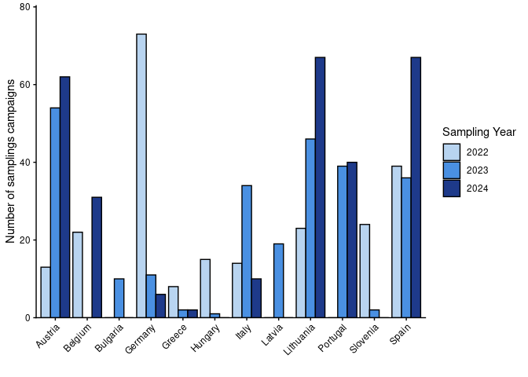<!-- -->

#### Numer of Rivers sampled per year and country

  - Table

<!-- end list -->

    ## # A tibble: 28 × 3
    ## # Groups:   CountryResponsible [12]
    ##    CountryResponsible SamplingYear Rivers
    ##    <chr>                     <int>  <int>
    ##  1 austria                    2022     10
    ##  2 austria                    2023     35
    ##  3 austria                    2024     35
    ##  4 belgium                    2022     12
    ##  5 belgium                    2024     18
    ##  6 bulgaria                   2023      1
    ##  7 germany                    2022     58
    ##  8 germany                    2023     10
    ##  9 germany                    2024      5
    ## 10 greece                     2022      7
    ## # ℹ 18 more rows

  - Plot (without numbers)

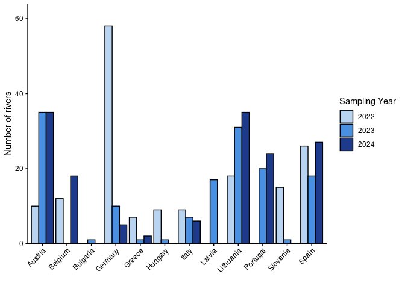<!-- -->

  - Plot (with numbers)

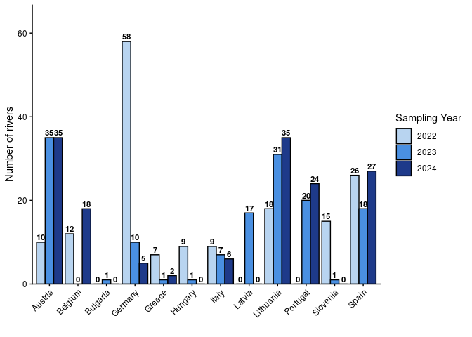<!-- -->

Crearemos una sola figura con las dos gráficas.

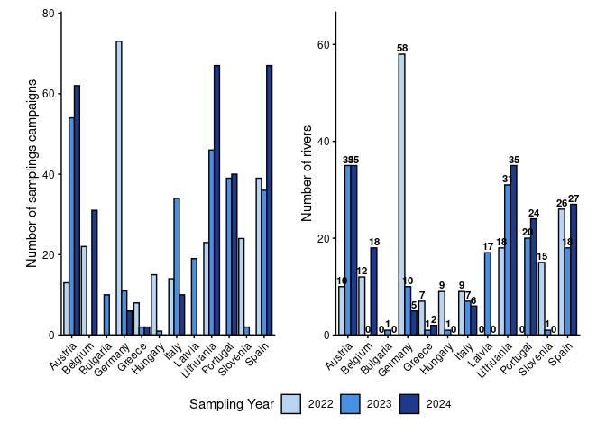<!-- -->

### Sampling Effort Description

The sampling effort of each Group B survey is defined by the size of the
riverbank area searched, recorded in two attributes:

  - `RiversideWasteVariety_Results_LengthOfRiverbankSearchedM`: length
    of the riverbank searched (m).
  - `RiversideWasteVariety_Results_WidthOfRiverbankSearchedM`: width of
    the riverbank searched (m).

According to the dataset documentation
(`READme_info_riverbank_v2.0.0.txt`), *“Data for length and width of
riverbank searched for group B could not always be verified by the
experts”*. Therefore, before using them (e.g. to standardise litter
counts per m²), we describe (i) the amount of missing values and (ii)
their variability, looking for outliers.

**Note:** the CSV codes missing values both as `"na"` and as `"NA"`.
Both are declared as missing in `DataLoading` (`na.strings = c("na",
"NA")`), so length and width are read as numeric. Otherwise, the width
attribute would be read as text because of the literal `"NA"` cells.

#### Missing values

For each attribute we count the missing values (`NA`), and for the
combination of both we count the *complete cases* (rows with both length
and width). The *Incomplete* columns show how many records, and what
percentage of the total, would be removed if we kept only complete
cases. This is shown for the whole dataset, for the attempted samplings
and for the validated Group B samplings (the subset used in the
analyses).

    ##                Subset   N NA Length (n) NA Length (%) NA Width (n) NA Width (%)
    ## 1         All records 770            84          10.9           82         10.6
    ## 2  Attempted sampling 742            56           7.5           54          7.3
    ## 3 Validated (Group B) 545             8           1.5           14          2.6
    ##   NA Both (n) Incomplete (n) Incomplete (%) Complete cases (n)
    ## 1          74             92           11.9                678
    ## 2          46             64            8.6                678
    ## 3           7             15            2.8                530
    ##   Complete cases (%)
    ## 1               88.1
    ## 2               91.4
    ## 3               97.2

In the validated Group B dataset, 15 out of 545 samplings (2.8%) lack
the length, the width or both. Keeping only complete cases would remove
that share of the data.

Missing values per country (validated Group B samplings), to check
whether they are concentrated in a few countries:

    ## # A tibble: 12 × 6
    ##    CountryResponsible     N `NA Length (n)` `NA Width (n)` `Incomplete (n)`
    ##    <chr>              <int>           <int>          <int>            <int>
    ##  1 Italy                 51               2              5                5
    ##  2 Slovenia              24               1              1                2
    ##  3 Portugal              45               2              3                3
    ##  4 Germany               84               1              3                3
    ##  5 Spain                 86               2              2                2
    ##  6 Austria               70               0              0                0
    ##  7 Belgium               49               0              0                0
    ##  8 Bulgaria              10               0              0                0
    ##  9 Greece                11               0              0                0
    ## 10 Hungary               15               0              0                0
    ## 11 Latvia                10               0              0                0
    ## 12 Lithuania             90               0              0                0
    ## # ℹ 1 more variable: `Incomplete (%)` <dbl>

#### Variability and outliers

Descriptive statistics of the validated Group B samplings. Zero values
are also counted, since a searched length or width of 0 m is not
plausible.

Both attributes are strongly concentrated around a few “standard” values
(most samplings searched about 50 m × 20 m) and have long right tails.
Under these conditions Tukey’s IQR rule is not useful: the width IQR is
very narrow (15–20 m), so the rule flags around a quarter of the
samplings as outliers, even on a log scale. Instead, we flag as
**extreme values** those below the lower or above the upper percentile
set in `pct_limits` (by default the 1st and 99th percentiles), plus all
zero values. The limits can be changed to make the criterion more or
less strict.

    ## # A tibble: 3 × 13
    ##   Variable     n  `NA` Zeros   Min P_low    Q1 Median   Mean    Q3 P_high    Max
    ##   <fct>    <int> <int> <int> <dbl> <dbl> <dbl>  <dbl>  <dbl> <dbl>  <dbl>  <dbl>
    ## 1 Length_m   537     8     2     0  7.21    40     50   91.4    85   700  1.37e3
    ## 2 Width_m    531    14     2     0  2       15     20   24.3    20   100  1.5 e3
    ## 3 Area_m2    530    15     2     0 36.7    600   1000 4287.   1600 16988. 1.05e6
    ## # ℹ 1 more variable: `Extreme (n)` <int>

Both attributes are strongly right-skewed (the mean is much higher than
the median), so the histograms use a logarithmic x-axis. Zero values
cannot be shown on a log scale and are excluded from the plots (they are
counted in the table above). The solid line marks the median and the
dashed lines the percentile limits. The scatter plot combines both
attributes; the grey diagonal lines show constant searched areas (100,
1,000, 10,000 and 100,000 m²).

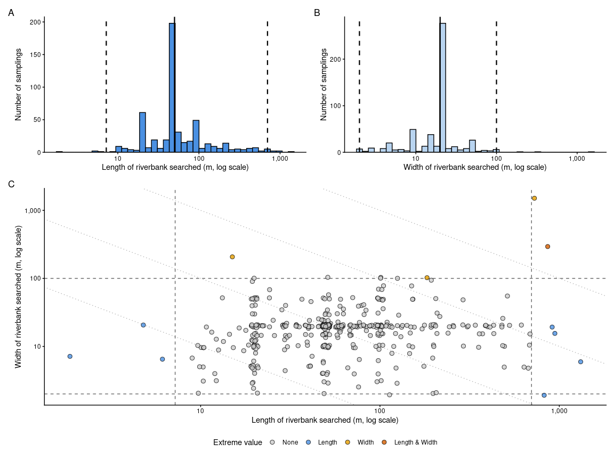<!-- -->

Distribution of length and width per country, to check whether outliers
are specific to some countries (zero values excluded):

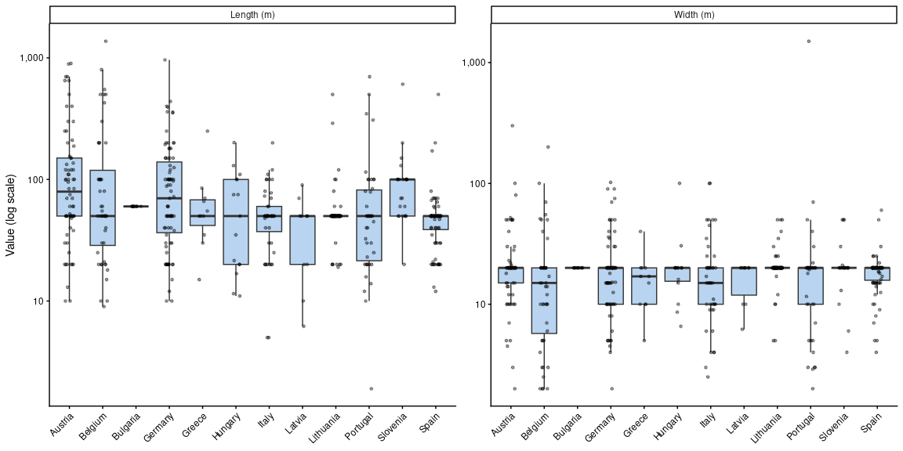<!-- -->

List of the validated samplings with extreme values (outside the
percentile limits, or zero) in length or width, ordered by searched
area, for manual checking:

    ##    DatasetID CountryResponsible SamplingYear   SamplingRiver Length_m Width_m
    ## 1    pt_6762           Portugal         2023    Pinhão River    700.0  1500.0
    ## 2    at_6953            Austria         2023      Halterbach    900.0   300.0
    ## 3    de_6249            Germany         2022    Lauter River    180.0   102.0
    ## 4    at_7163            Austria         2024            Ager    890.0    20.0
    ## 5    de_6326            Germany         2022     Hunte River    962.0    15.0
    ## 6    be_6325            Belgium         2022   Scheldt River   1370.0     6.0
    ## 7    be_7292            Belgium         2024     Kleine Nete     15.0   200.0
    ## 8    be_6444            Belgium         2022      Yser River    800.0     2.0
    ## 9    it_6572              Italy         2022     Tiber River      5.0    20.0
    ## 10   lv_7074             Latvia         2023           Vaive      6.2     6.2
    ## 11   pt_6608           Portugal         2023 Carenque Stream      1.9     7.0
    ## 12   be_6516            Belgium         2022    Dommel River      0.0     0.0
    ## 13   it_7104              Italy         2023     Tiber River      0.0     0.0
    ## 14   it_6552              Italy         2022     Carabollace      5.0      NA
    ##      Area_m2        Extreme
    ## 1  1.050e+06          Width
    ## 2  2.700e+05 Length & Width
    ## 3  1.836e+04          Width
    ## 4  1.780e+04         Length
    ## 5  1.443e+04         Length
    ## 6  8.220e+03         Length
    ## 7  3.000e+03          Width
    ## 8  1.600e+03         Length
    ## 9  1.000e+02         Length
    ## 10 3.844e+01         Length
    ## 11 1.330e+01         Length
    ## 12 0.000e+00 Length & Width
    ## 13 0.000e+00 Length & Width
    ## 14        NA         Length

### Most common types and quantities of litter per region? (Group B: riverbanks; Group C: floating litter)

#### Group B: Riverside Waste

Statistics of the variable `RiversideWasteVariety_AttemptedSampling` to
see how many samplings were performed.

    ## RiversideWasteVariety_AttemptedSampling
    ##   0   1 
    ##  26 742

To work with the `RiversideWasteVariety_` data, we need to filter the
dataset to include only those rows where
`RiversideWasteVariety_AttemptedSampling` is 1 (indicating that a
sampling was attempted) and `RiversideWasteVariety_Qualified` is also 1
(indicating that the sampling was qualified).

##### Percentage of qualified samplings

This represents the percentage of validated data among the total number
of sampling beign attempted.

    ##   total_rows total_valid pct_valid_total pct_valid_percent
    ## 1        770         545            70.8             70.8%

    ## # A tibble: 12 × 7
    ##    CountryResponsible total_rows total_valid `pct_valid_total(%)` total_attempts
    ##    <chr>                   <int>       <int>                <dbl>          <int>
    ##  1 Austria                   129          70                 54.3            116
    ##  2 Belgium                    53          49                 92.5             52
    ##  3 Bulgaria                   10          10                100               10
    ##  4 Germany                    90          84                 93.3             89
    ##  5 Greece                     12          11                 91.7             11
    ##  6 Hungary                    16          15                 93.8             16
    ##  7 Italy                      58          51                 87.9             55
    ##  8 Latvia                     19          10                 52.6             19
    ##  9 Lithuania                 136          90                 66.2            133
    ## 10 Portugal                   79          45                 57               77
    ## 11 Slovenia                   26          24                 92.3             25
    ## 12 Spain                     142          86                 60.6            139
    ## # ℹ 2 more variables: valid_among_attempts <int>,
    ## #   `pct_valid_among_attempts(%)` <dbl>

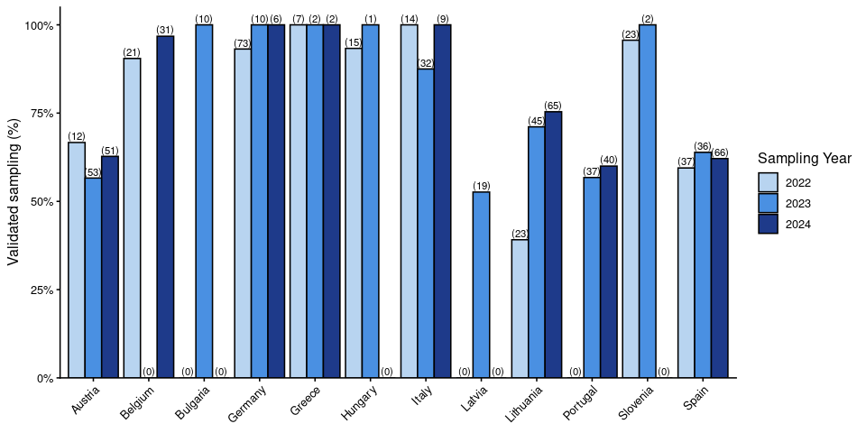<!-- -->

###### Manuscript values: validation rates (Sampling Effort)

Validation rate (% of attempted Group B samplings that were validated)
per country and year, as in Fig. 2C, and the lowest rate among the
countries described in the manuscript as having high validation rates.

    ## # A tibble: 12 × 4
    ##    CountryResponsible `2022` `2023` `2024`
    ##    <chr>               <dbl>  <dbl>  <dbl>
    ##  1 Austria              66.7   56.6   62.7
    ##  2 Belgium              90.5   NA     96.8
    ##  3 Bulgaria             NA    100     NA  
    ##  4 Germany              93.2  100    100  
    ##  5 Greece              100    100    100  
    ##  6 Hungary              93.3  100     NA  
    ##  7 Italy               100     87.5  100  
    ##  8 Latvia               NA     52.6   NA  
    ##  9 Lithuania            39.1   71.1   75.4
    ## 10 Portugal             NA     56.8   60  
    ## 11 Slovenia             95.7  100     NA  
    ## 12 Spain                59.5   63.9   62.1

    ## # A tibble: 5 × 5
    ##   CountryResponsible SamplingYear n_attempted n_validated pct_validated
    ##   <chr>                     <int>       <int>       <int>         <dbl>
    ## 1 Italy                      2023          32          28          87.5
    ## 2 Belgium                    2022          21          19          90.5
    ## 3 Germany                    2022          73          68          93.2
    ## 4 Hungary                    2022          15          14          93.3
    ## 5 Slovenia                   2022          23          22          95.7

##### Most common types/quantities of litter

Firstly, we will pick up data to answer the question about group B. Only
some variables are taken from the general dataset.

The, Attributes’ names are so complicated to work that I’ll remote the
preceding information **RiversideWasteVariety\_Results\_** which is
common to all attributes; and finally to work with only the validated
`Group B` dataset we create:

**CAUTION**\! There are some `NAs` values in the litter items that are
probably incorrect since the groups did find other items.

After meeting and email from Charlotte, we realise that NA in group B
for some items it’s really a zero. So we update these columns replacing
`NA` values with a `0`.

###### Litter type abundance

We will obtain the plot for the most common (average abundance) litter
type, as a table and then as a plot.

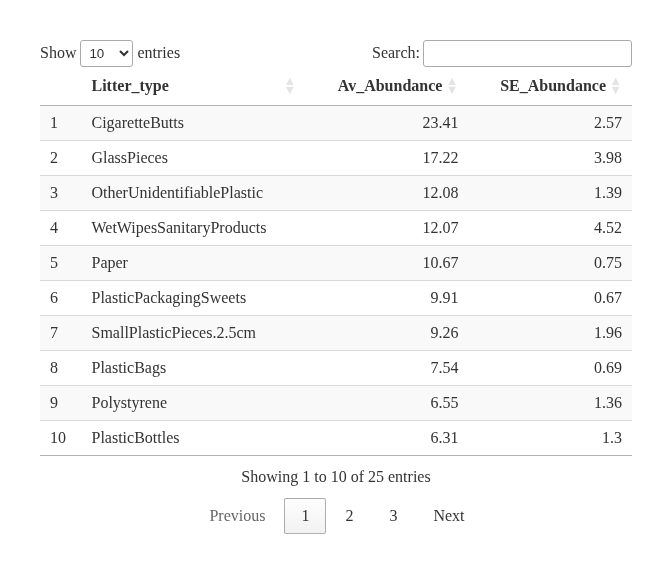<!-- -->

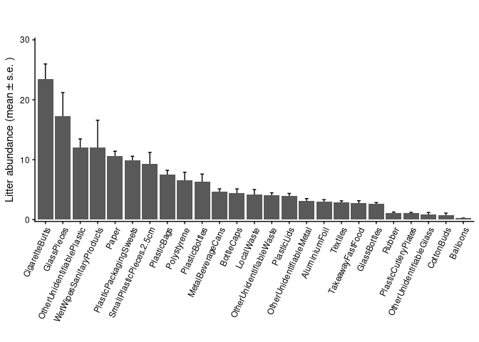<!-- -->

###### Litter type abundance per country

If we now want to visualize the contribution per each country, we have:

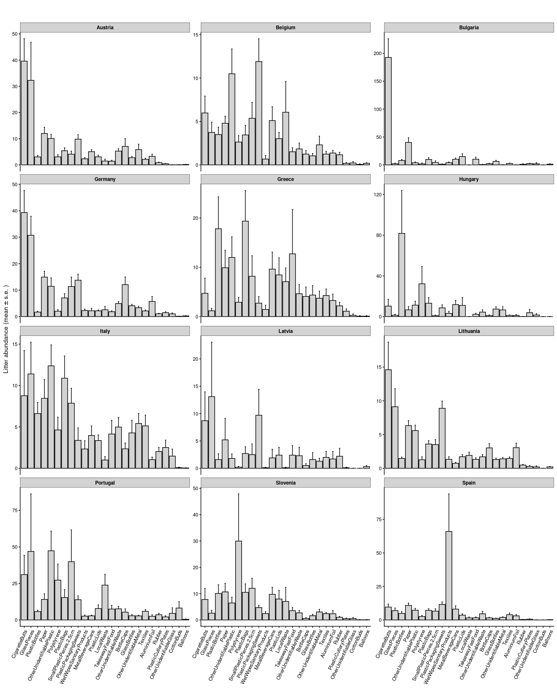<!-- -->

###### Manuscript values: mean ± s.e. and n (Fig. 3 and Fig. 4)

Mean ± standard error (rounded to one decimal) and number of validated
samplings (*n*) for the litter categories and countries cited in the
Results section.

    ## # A tibble: 4 × 5
    ##   Litter_type                    n  Mean    SE Manuscript         
    ##   <chr>                      <int> <dbl> <dbl> <chr>              
    ## 1 CigaretteButts               545  23.4  2.57 23.4 ± 2.6, n = 545
    ## 2 GlassPieces                  545  17.2  3.98 17.2 ± 4.0, n = 545
    ## 3 OtherUnidentifiablePlastic   545  12.1  1.39 12.1 ± 1.4, n = 545
    ## 4 WetWipesSanitaryProducts     545  12.1  4.52 12.1 ± 4.5, n = 545

    ## # A tibble: 16 × 3
    ##    Litter_type                CountryResponsible Manuscript          
    ##    <chr>                      <chr>              <chr>               
    ##  1 CigaretteButts             Bulgaria           192.6 ± 33.5, n = 10
    ##  2 CigaretteButts             Austria            39.6 ± 8.5, n = 70  
    ##  3 CigaretteButts             Germany            39.3 ± 8.4, n = 84  
    ##  4 CigaretteButts             Lithuania          14.6 ± 4.1, n = 90  
    ##  5 GlassPieces                Austria            32.3 ± 14.6, n = 70 
    ##  6 GlassPieces                Germany            30.7 ± 7.2, n = 84  
    ##  7 GlassPieces                Italy              11.4 ± 3.8, n = 51  
    ##  8 GlassPieces                Portugal           46.9 ± 39.4, n = 45 
    ##  9 GlassPieces                Lithuania          9.1 ± 2.7, n = 90   
    ## 10 PlasticBottles             Hungary            81.7 ± 42.2, n = 15 
    ## 11 PlasticBottles             Greece             17.8 ± 6.5, n = 11  
    ## 12 PlasticBags                Greece             19.4 ± 6.2, n = 11  
    ## 13 Polystyrene                Slovenia           30.0 ± 18.0, n = 24 
    ## 14 WetWipesSanitaryProducts   Spain              65.9 ± 28.1, n = 86 
    ## 15 PlasticPackagingSweets     Belgium            11.9 ± 2.6, n = 49  
    ## 16 OtherUnidentifiablePlastic Belgium            10.5 ± 2.9, n = 49

###### Litter type Proportion I - “Across‑type” proportions

  - The first approach will be a “*Across‑type*” proportions.
      - For each litter type, what fraction comes from each country?
        (not from an european total)
      - total abundance of that litter type over each total country.

<!-- end list -->

    ## # A tibble: 300 × 5
    ##    CountryResponsible Litter_type      Total_Abundance Global_Total Prop_Country
    ##    <chr>              <chr>                      <dbl>        <dbl>        <dbl>
    ##  1 austria            AluminiumFoil                228         1613      0.141  
    ##  2 austria            Balloons                      11          125      0.088  
    ##  3 austria            BottleCaps                   494         2441      0.202  
    ##  4 austria            CigaretteButts              2773        12759      0.217  
    ##  5 austria            CottonBuds                     4          394      0.0102 
    ##  6 austria            GlassBottles                 192         1431      0.134  
    ##  7 austria            GlassPieces                 2260         9387      0.241  
    ##  8 austria            LocalWaste                   103         2296      0.0449 
    ##  9 austria            MetalBeverageCa…             353         2521      0.140  
    ## 10 austria            OtherUnidentifi…               3          462      0.00649
    ## # ℹ 290 more rows

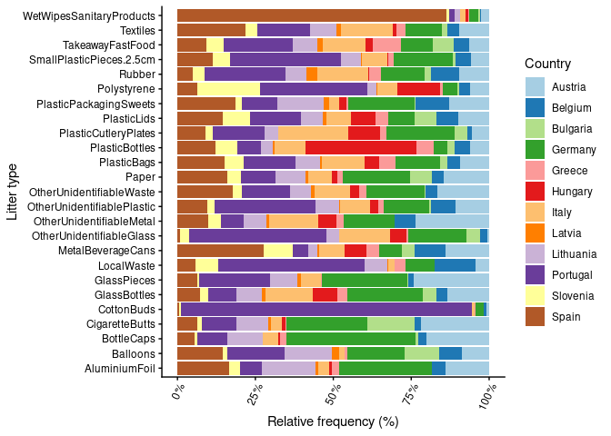<!-- -->

  - Now, considering the total of Europe

<!-- end list -->

    ## # A tibble: 300 × 5
    ##    CountryResponsible Litter_type  Total_Abundance European_Total Prop_of_Europe
    ##    <chr>              <fct>                  <dbl>          <dbl>          <dbl>
    ##  1 Austria            AluminiumFo…             228           1613        0.141  
    ##  2 Austria            Balloons                  11            125        0.088  
    ##  3 Austria            BottleCaps               494           2441        0.202  
    ##  4 Austria            CigaretteBu…            2773          12759        0.217  
    ##  5 Austria            CottonBuds                 4            394        0.0102 
    ##  6 Austria            GlassBottles             192           1431        0.134  
    ##  7 Austria            GlassPieces             2260           9387        0.241  
    ##  8 Austria            LocalWaste               103           2296        0.0449 
    ##  9 Austria            MetalBevera…             353           2521        0.140  
    ## 10 Austria            OtherUniden…               3            462        0.00649
    ## # ℹ 290 more rows

To compare and validate the output, for each `litter_type` the
`European_Total` have to be the same.

    ## # A tibble: 12 × 5
    ##    CountryResponsible Litter_type  Total_Abundance European_Total Prop_of_Europe
    ##    <chr>              <fct>                  <dbl>          <dbl>          <dbl>
    ##  1 Austria            AluminiumFo…             228           1613       0.141   
    ##  2 Belgium            AluminiumFo…              67           1613       0.0415  
    ##  3 Bulgaria           AluminiumFo…               1           1613       0.000620
    ##  4 Germany            AluminiumFo…             481           1613       0.298   
    ##  5 Greece             AluminiumFo…              36           1613       0.0223  
    ##  6 Hungary            AluminiumFo…              17           1613       0.0105  
    ##  7 Italy              AluminiumFo…              53           1613       0.0329  
    ##  8 Latvia             AluminiumFo…              17           1613       0.0105  
    ##  9 Lithuania          AluminiumFo…             275           1613       0.170   
    ## 10 Portugal           AluminiumFo…             115           1613       0.0713  
    ## 11 Slovenia           AluminiumFo…              57           1613       0.0353  
    ## 12 Spain              AluminiumFo…             266           1613       0.165

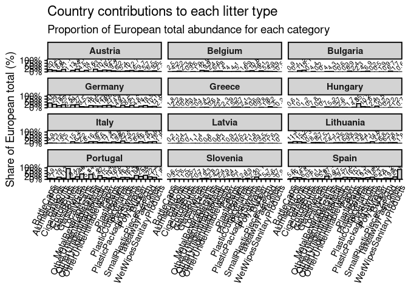

  - HeatMaps

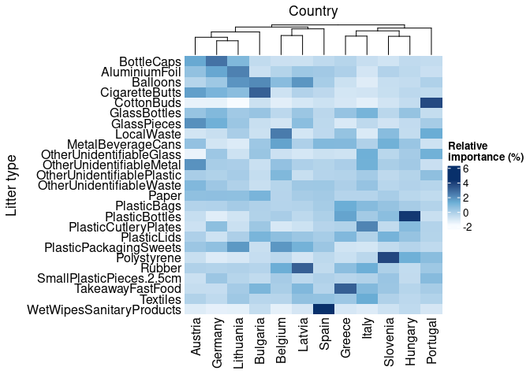

Bootstrap implementation in the dendrograms nodes. It replaces the
previous heatmap with the dendrograms based on bootstrap values.

    ## Bootstrap (r = 0.48)... Done.
    ## Bootstrap (r = 0.6)... Done.
    ## Bootstrap (r = 0.68)... Done.
    ## Bootstrap (r = 0.8)... Done.
    ## Bootstrap (r = 0.88)... Done.
    ## Bootstrap (r = 1.0)... Done.
    ## Bootstrap (r = 1.08)... Done.
    ## Bootstrap (r = 1.2)... Done.
    ## Bootstrap (r = 1.28)... Done.
    ## Bootstrap (r = 1.4)... Done.

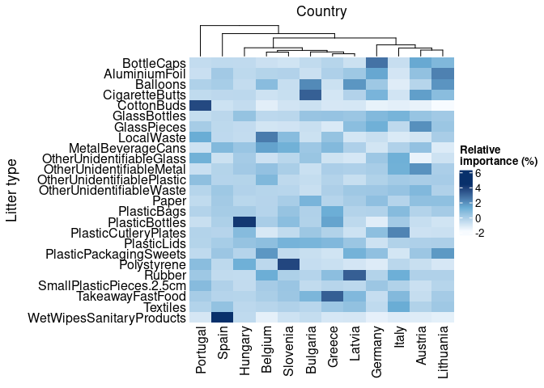<!-- -->

Dendrogram with the values

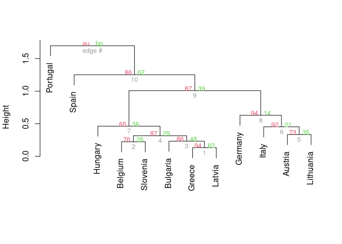<!-- -->

    ## png 
    ##   2

<!--
###### Litter type Proportion II - "Within‑country" proportions

* The second approach will be a "*Within‑country*" proportions. 
  * For each country, what fraction of its total litter is each type?
  * Total abundance of all types in that country.


```
## # A tibble: 300 × 5
##    CountryResponsible Litter_type        Total_Abundance Country_Total Prop_Type
##    <chr>              <chr>                        <dbl>         <dbl>     <dbl>
##  1 austria            AluminiumFoil                  228         11246  0.0203  
##  2 austria            Balloons                        11         11246  0.000978
##  3 austria            BottleCaps                     494         11246  0.0439  
##  4 austria            CigaretteButts                2773         11246  0.247   
##  5 austria            CottonBuds                       4         11246  0.000356
##  6 austria            GlassBottles                   192         11246  0.0171  
##  7 austria            GlassPieces                   2260         11246  0.201   
##  8 austria            LocalWaste                     103         11246  0.00916 
##  9 austria            MetalBeverageCans              353         11246  0.0314  
## 10 austria            OtherUnidentifiab…               3         11246  0.000267
## # ℹ 290 more rows
```


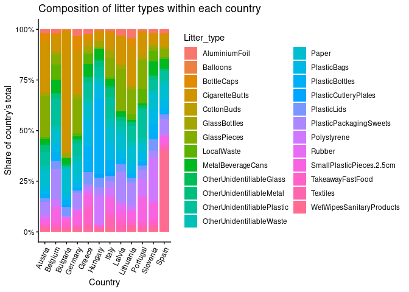<!-- -->

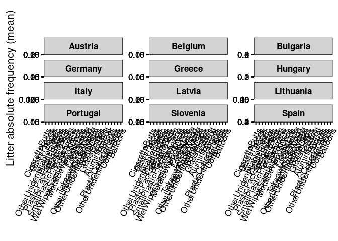<!-- -->

–\>

###### Multivariate Perspective

In order to see if there are significant differences across country in
the community composition, we will perform a PERMANOVA test:

    ## Permutation test for adonis under reduced model
    ## Marginal effects of terms
    ## Permutation: free
    ## Number of permutations: 999
    ## 
    ## adonis2(formula = dist_mat ~ CountryResponsible, data = meta, permutations = 999, by = "margin", na.action = na.omit)
    ##                     Df SumOfSqs      R2      F Pr(>F)    
    ## CountryResponsible  11   27.362 0.09899 5.2535  0.001 ***
    ## Residual           526  249.052 0.90101                  
    ## Total              537  276.414 1.00000                  
    ## ---
    ## Signif. codes:  0 '***' 0.001 '**' 0.01 '*' 0.05 '.' 0.1 ' ' 1

So, we conclude that there are significant differences among countries.

We can look for **heterocedasticity** among countries (homogeneity of
multivariate dispersions), since PERMANOVA can also detect differences
in dispersion and not only in location:

    ## 
    ##  Homogeneity of multivariate dispersions
    ## 
    ## Call: betadisper(d = dist_mat, group = meta$CountryResponsible)
    ## 
    ## No. of Positive Eigenvalues: 25
    ## No. of Negative Eigenvalues: 0
    ## 
    ## Average distance to median:
    ##   austria   belgium  bulgaria   germany    greece   hungary     italy    latvia 
    ##    0.6550    0.6981    0.3731    0.6561    0.5943    0.6351    0.7082    0.6479 
    ## lithuania  portugal  slovenia     spain 
    ##    0.6720    0.6830    0.6464    0.6964 
    ## 
    ## Eigenvalues for PCoA axes:
    ## (Showing 8 of 25 eigenvalues)
    ## PCoA1 PCoA2 PCoA3 PCoA4 PCoA5 PCoA6 PCoA7 PCoA8 
    ## 39.70 25.03 22.93 20.66 18.41 16.90 15.74 13.57

    ## 
    ## Permutation test for homogeneity of multivariate dispersions
    ## Permutation: free
    ## Number of permutations: 999
    ## 
    ## Response: Distances
    ##            Df Sum Sq  Mean Sq      F N.Perm Pr(>F)    
    ## Groups     11 1.1883 0.108023 6.8969    999  0.001 ***
    ## Residuals 526 8.2385 0.015663                         
    ## ---
    ## Signif. codes:  0 '***' 0.001 '**' 0.01 '*' 0.05 '.' 0.1 ' ' 1

The multivariate dispersion **differs significantly** among countries
(betadisper; F = 6.9, p = 0.001), so part of the PERMANOVA result may
reflect differences in within-country variability rather than only in
composition.

But what are the items that explain these differences?

The answer will be addressed by performing a **Multivariate Random
Forest**.

    ## 
    ## Call:
    ##  randomForest(x = comm_hel, y = as.factor(meta$CountryResponsible),      ntree = 500, importance = TRUE) 
    ##                Type of random forest: classification
    ##                      Number of trees: 500
    ## No. of variables tried at each split: 5
    ## 
    ##         OOB estimate of  error rate: 66.17%
    ## Confusion matrix:
    ##           austria belgium bulgaria germany greece hungary italy latvia
    ## austria        19       4        0      14      0       0     5      0
    ## belgium         8       5        0       3      0       0     4      0
    ## bulgaria        0       0        9       0      0       1     0      0
    ## germany         7       2        0      38      0       0     3      0
    ## greece          1       0        0       0      0       0     6      0
    ## hungary         5       1        0       0      0       3     1      0
    ## italy          10       4        0       7      0       0    16      0
    ## latvia          0       0        0       2      0       0     0      0
    ## lithuania       5       1        0      26      0       0     2      0
    ## portugal        6       3        0       7      0       0     6      0
    ## slovenia        3       0        0       0      0       0     4      0
    ## spain          14       6        0       5      0       1     6      0
    ##           lithuania portugal slovenia spain class.error
    ## austria           8        1        0    19   0.7285714
    ## belgium          15        0        0    12   0.8936170
    ## bulgaria          0        0        0     0   0.1000000
    ## germany          21        7        0     6   0.5476190
    ## greece            0        2        0     2   1.0000000
    ## hungary           0        0        0     5   0.8000000
    ## italy             3        3        2     6   0.6862745
    ## latvia            5        0        0     1   1.0000000
    ## lithuania        41        3        0    11   0.5393258
    ## portugal          7       11        0     5   0.7555556
    ## slovenia          1        3        2    11   0.9166667
    ## spain            13        0        1    38   0.5476190

Decisions have to be taken carefully since the prediction accuracy is
very low (0.34). Furthermore, the estimated error rate (OOB) is high, so
conclusion have to be taken with care.

Eventhough, the more important (differential across countries) litter
components are:

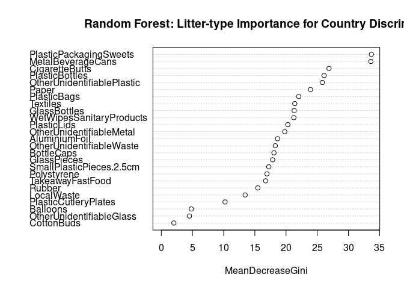

This plot of variable importance importance is telling us:

<!--
*  A large `MeanDecreaseAccuracy` (**MDA**) means that, when you break the relationship between that predictor and the response, the model’s accuracy suffers a lot → it’s an important predictor for correct country assignments. 
  * **MDA** is generally the more reliable gauge of predictive importance, since it directly measures impact on OOB‐accuracy.
-->

  - A large `MeanDecreaseGini` (**MDG**) means that X frequently appears
    in high‑up the tree splits and yields big purity gains → it’s
    structurally important to partitioning the data.
      - **MDG** tells you which features the trees “prefer” splitting
        on.
  - **Principal Component Analysis**

We will perform a Principal Component Analysis (PCA) to see correlation
among litter items and *possible* associations with countries

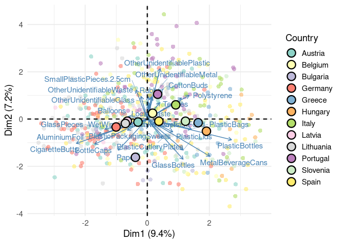<!-- -->

And the most important Items for the two forst principal components are:

  - First PC
    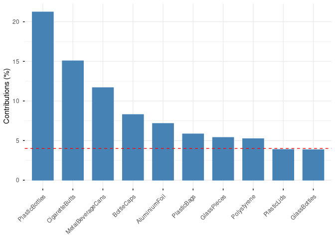<!-- -->

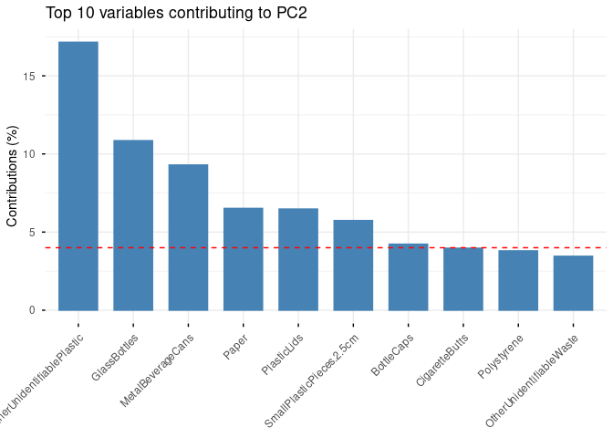<!-- -->

  - **Non-Metric Multidimensional Scaling - nMDS**

We will perform a Non-Metric Multidimensional Scaling (nMDS) to see
correlation among litter items and *possible* associations with
countries.

We can re-use the distance matrix using the hellinger‐transformed data
(`comm_hel`) and then perform the nMDS.

    ## [1] 0

    ## integer(0)

    ## Run 0 stress 0.2884093 
    ## Run 1 stress 0.2897636 
    ## Run 2 stress 0.289213 
    ## Run 3 stress 0.2927784 
    ## Run 4 stress 0.2999241 
    ## Run 5 stress 0.2893695 
    ## Run 6 stress 0.2902012 
    ## Run 7 stress 0.305738 
    ## Run 8 stress 0.2962467 
    ## Run 9 stress 0.2889845 
    ## Run 10 stress 0.288933 
    ## Run 11 stress 0.2898935 
    ## Run 12 stress 0.2926103 
    ## Run 13 stress 0.3003172 
    ## Run 14 stress 0.2898649 
    ## Run 15 stress 0.2987554 
    ## Run 16 stress 0.2911705 
    ## Run 17 stress 0.2894898 
    ## Run 18 stress 0.2925373 
    ## Run 19 stress 0.2910448 
    ## Run 20 stress 0.290997 
    ## *** Best solution was not repeated -- monoMDS stopping criteria:
    ##     17: no. of iterations >= maxit
    ##      3: stress ratio > sratmax

Now, we calculate the scores for the sites (samples) and add the
metadata to be able to visualize the nMDS with the country information.

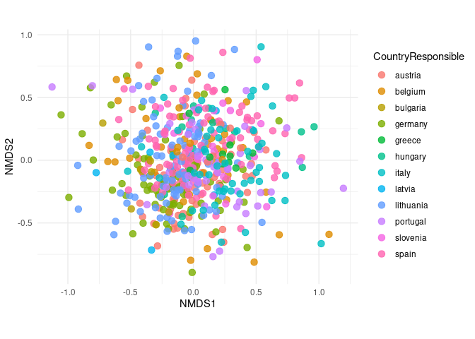<!-- -->

To see which countries are more similar than others, we can calculate
the centroids of each country in the NMDS space and then plot them.

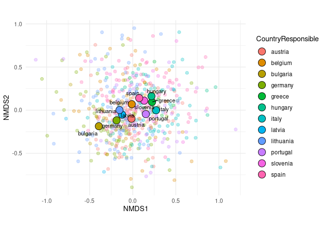<!-- -->

From the above plot, we can say that the non-metric multidimensional
scaling ordination based on Bray–Curtis dissimilarities of
Hellinger-transformed litter composition revealed a clear gradient along
the first two NMDS axes. Countries are arranged in a roughly linear
sequence in this ordination space, indicating systematic shifts in the
relative contribution of the different litter categories rather than
discrete clusters. This pattern suggests that national litter profiles
form a continuum, with some countries showing more similar compositions
and therefore grouping closer together, while others occupy more distant
positions along the gradient. Taken together, the NMDS indicates that
between-country variation in litter is primarily structured along one
dominant compositional axis, with a secondary axis capturing finer
differences among otherwise similar profiles.

#### Group B: Single Use Plastic - Riverside Waste

We wil take as a subset the single use plastic (`SUP`) for the group B.

    ##   DatasetID CountryResponsible SamplingCampaign SamplingYear
    ## 1   at_6270            austria      autumn 2022         2022
    ## 2   at_6297            austria      autumn 2022         2022
    ## 3   at_6382            austria      autumn 2022         2022
    ## 4   at_6393            austria      autumn 2022         2022
    ## 5   at_6429            austria      autumn 2022         2022
    ## 6   at_6448            austria      autumn 2022         2022
    ##   SamplingCoordinatesLatitude SamplingCoordinatesLongitude SamplingRiverSystem
    ## 1                    48.04275                     14.42192              Danube
    ## 2                    48.26034                     13.03440              Danube
    ## 3                    47.11828                     13.81419              Danube
    ## 4                    46.58301                     13.84115              Danube
    ## 5                    48.21108                     16.43973              Danube
    ## 6                    46.60477                     14.27800              Danube
    ##   SamplingParticipants RiversideWasteVariety_AttemptedSampling
    ## 1                    9                                       1
    ## 2                    8                                       1
    ## 3                   20                                       1
    ## 4                   38                                       1
    ## 5                   20                                       1
    ## 6                   16                                       1
    ##   RiversideWasteVariety_Qualified PlasticBags PlasticBottles PlasticLids
    ## 1                               1           2              0           0
    ## 2                               1           0              1           4
    ## 3                               1           0              0           0
    ## 4                               1          34             22          13
    ## 5                               1           7             22          17
    ## 6                               1           3              4           1
    ##   TakeawayFastFood PlasticCutleryPlates PlasticPackagingSweets CottonBuds
    ## 1                2                    0                      1          0
    ## 2                1                    1                     14          0
    ## 3                0                    0                      2          0
    ## 4                2                    0                     34          0
    ## 5                9                    3                     10          2
    ## 6                3                    0                      1          0
    ##   WetWipesSanitaryProducts Polystyrene
    ## 1                        1           0
    ## 2                        3           0
    ## 3                        0           1
    ## 4                        0           0
    ## 5                        7           6
    ## 6                        0           0

    ##    DatasetID   CountryResponsible    SamplingCampaign  SamplingYear 
    ##  at_6270:  1   Length   :545      autumn 2021:  0     Min.   :2022  
    ##  at_6297:  1   N.unique : 12      autumn 2022:194     1st Qu.:2022  
    ##  at_6382:  1   N.blank  :  0      autumn 2023:142     Median :2023  
    ##  at_6393:  1   Min.nchar:  5      autumn 2024: 50     Mean   :2023  
    ##  at_6429:  1   Max.nchar:  9      spring 2022:  1     3rd Qu.:2024  
    ##  at_6448:  1                      spring 2023: 26     Max.   :2024  
    ##  (Other):539                      spring 2024:132                   
    ##  SamplingCoordinatesLatitude SamplingCoordinatesLongitude SamplingRiverSystem
    ##  Min.   :37.18               Min.   :-9.309               Length   :545      
    ##  1st Qu.:42.03               1st Qu.: 2.879               N.unique : 45      
    ##  Median :48.01               Median :12.250               N.blank  :  0      
    ##  Mean   :47.47               Mean   :10.871               Min.nchar:  2      
    ##  3rd Qu.:51.39               3rd Qu.:17.470               Max.nchar: 27      
    ##  Max.   :57.75               Max.   :27.488                                  
    ##                                                                              
    ##  SamplingParticipants RiversideWasteVariety_AttemptedSampling
    ##  Min.   :  2.00       Min.   :1                              
    ##  1st Qu.: 13.00       1st Qu.:1                              
    ##  Median : 19.00       Median :1                              
    ##  Mean   : 19.58       Mean   :1                              
    ##  3rd Qu.: 24.00       3rd Qu.:1                              
    ##  Max.   :250.00       Max.   :1                              
    ##  NAs    :9                                                   
    ##  RiversideWasteVariety_Qualified  PlasticBags      PlasticBottles   
    ##  Min.   :1                       Min.   :  0.000   Min.   :  0.000  
    ##  1st Qu.:1                       1st Qu.:  0.000   1st Qu.:  0.000  
    ##  Median :1                       Median :  3.000   Median :  1.000  
    ##  Mean   :1                       Mean   :  7.543   Mean   :  6.306  
    ##  3rd Qu.:1                       3rd Qu.:  7.000   3rd Qu.:  4.000  
    ##  Max.   :1                       Max.   :196.000   Max.   :576.000  
    ##                                                                     
    ##   PlasticLids     TakeawayFastFood  PlasticCutleryPlates PlasticPackagingSweets
    ##  Min.   :  0.00   Min.   :  0.000   Min.   : 0.000       Min.   :  0.00        
    ##  1st Qu.:  0.00   1st Qu.:  0.000   1st Qu.: 0.000       1st Qu.:  1.00        
    ##  Median :  1.00   Median :  0.000   Median : 0.000       Median :  4.00        
    ##  Mean   :  3.96   Mean   :  2.791   Mean   : 1.048       Mean   :  9.91        
    ##  3rd Qu.:  4.00   3rd Qu.:  2.000   3rd Qu.: 1.000       3rd Qu.: 11.00        
    ##  Max.   :115.00   Max.   :102.000   Max.   :49.000       Max.   :121.00        
    ##                                                                                
    ##    CottonBuds       WetWipesSanitaryProducts  Polystyrene     
    ##  Min.   :  0.0000   Min.   :   0.00          Min.   :  0.000  
    ##  1st Qu.:  0.0000   1st Qu.:   0.00          1st Qu.:  0.000  
    ##  Median :  0.0000   Median :   0.00          Median :  0.000  
    ##  Mean   :  0.7229   Mean   :  12.07          Mean   :  6.554  
    ##  3rd Qu.:  0.0000   3rd Qu.:   2.00          3rd Qu.:  2.000  
    ##  Max.   :145.0000   Max.   :1897.00          Max.   :423.000  
    ## 

###### SUP type abundance

We will obtain the plot for the most common (average abundance) Single
Use Plastic type
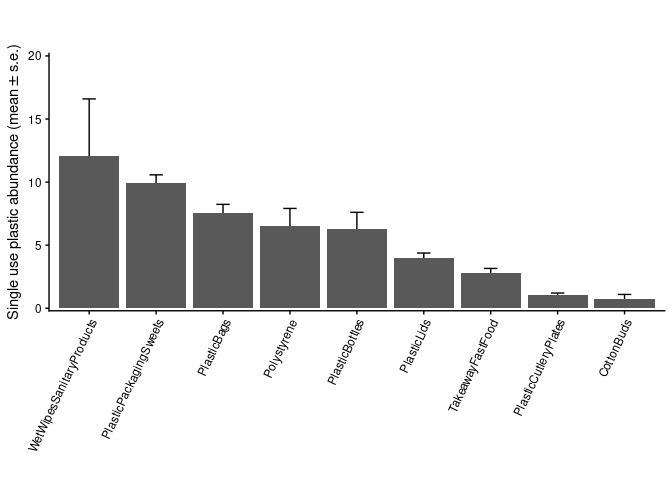<!-- -->

###### SUP type abundance per country

If we now want to visualize the contribution per each country, we have:

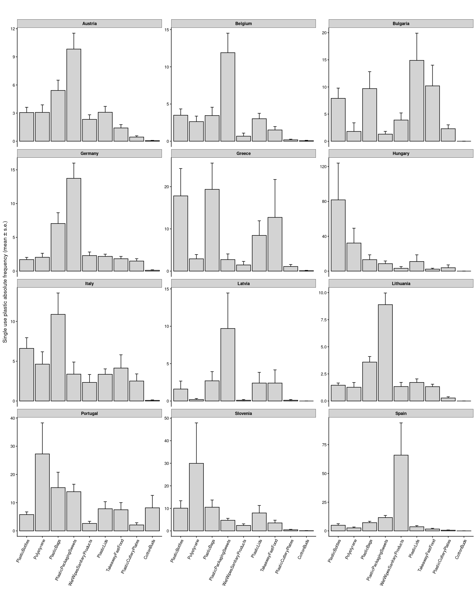<!-- -->

###### Manuscript values: SUP mean ± s.e. and n (Fig. 8 and Fig. 9)

Mean ± standard error (one decimal) and *n* for the SUP categories and
countries cited in the Results section (uses `litter_mean_se()`, defined
in the Group B section).

    ## # A tibble: 3 × 5
    ##   Litter_type                  n  Mean    SE Manuscript         
    ##   <chr>                    <int> <dbl> <dbl> <chr>              
    ## 1 WetWipesSanitaryProducts   545 12.1  4.52  12.1 ± 4.5, n = 545
    ## 2 PlasticPackagingSweets     545  9.91 0.665 9.9 ± 0.7, n = 545 
    ## 3 PlasticBags                545  7.54 0.693 7.5 ± 0.7, n = 545

    ## # A tibble: 8 × 3
    ##   Litter_type      CountryResponsible Manuscript         
    ##   <chr>            <chr>              <chr>              
    ## 1 PlasticBags      Italy              10.9 ± 2.7, n = 51 
    ## 2 PlasticBags      Greece             19.4 ± 6.2, n = 11 
    ## 3 Polystyrene      Portugal           27.3 ± 11.0, n = 45
    ## 4 Polystyrene      Slovenia           30.0 ± 18.0, n = 24
    ## 5 PlasticBottles   Hungary            81.7 ± 42.2, n = 15
    ## 6 PlasticBottles   Greece             17.8 ± 6.5, n = 11 
    ## 7 PlasticLids      Bulgaria           14.9 ± 5.0, n = 10 
    ## 8 TakeawayFastFood Bulgaria           10.2 ± 3.8, n = 10

###### SUP type Proportion I - “Across‑type” proportions

  - The first approach will be a “*Across‑type*” proportions.
      - total abundance of that litter type over each total country.

<!--
    * For each litter type, what fraction comes from each country? (not from an european total) 
    -->

    ## # A tibble: 108 × 5
    ##    CountryResponsible Litter_type      Total_Abundance Global_Total Prop_Country
    ##    <chr>              <chr>                      <dbl>        <dbl>        <dbl>
    ##  1 austria            CottonBuds                     4          394      0.0102 
    ##  2 austria            PlasticBags                  379         4111      0.0922 
    ##  3 austria            PlasticBottles               214         3437      0.0623 
    ##  4 austria            PlasticCutleryP…              31          571      0.0543 
    ##  5 austria            PlasticLids                  216         2158      0.100  
    ##  6 austria            PlasticPackagin…             688         5401      0.127  
    ##  7 austria            Polystyrene                  215         3572      0.0602 
    ##  8 austria            TakeawayFastFood              99         1521      0.0651 
    ##  9 austria            WetWipesSanitar…             163         6579      0.0248 
    ## 10 belgium            CottonBuds                     3          394      0.00761
    ## # ℹ 98 more rows

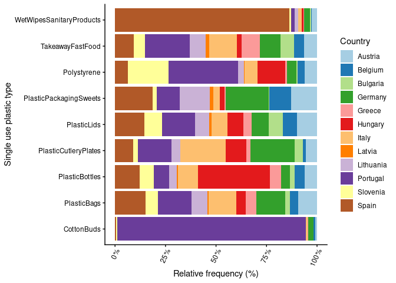<!-- -->

<!--

* Now, considering the total of Europe


```
## # A tibble: 108 × 5
##    CountryResponsible Litter_type  Total_Abundance European_Total Prop_of_Europe
##    <chr>              <fct>                  <dbl>          <dbl>          <dbl>
##  1 Austria            CottonBuds                 4            394        0.0102 
##  2 Austria            PlasticBags              379           4111        0.0922 
##  3 Austria            PlasticBott…             214           3437        0.0623 
##  4 Austria            PlasticCutl…              31            571        0.0543 
##  5 Austria            PlasticLids              216           2158        0.100  
##  6 Austria            PlasticPack…             688           5401        0.127  
##  7 Austria            Polystyrene              215           3572        0.0602 
##  8 Austria            TakeawayFas…              99           1521        0.0651 
##  9 Austria            WetWipesSan…             163           6579        0.0248 
## 10 Belgium            CottonBuds                 3            394        0.00761
## # ℹ 98 more rows
```


-->

  - HeatMaps

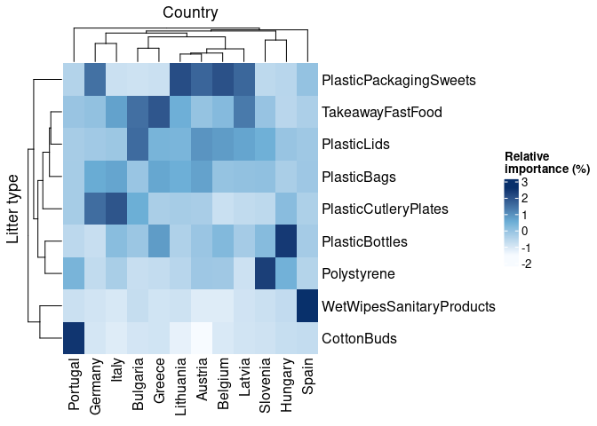

<!--

###### SUP type Proportion II - "Within‑country" proportions

* The second approach will be a "*Within‑country*" proportions. 
  * For each country, what fraction of its total litter is each type?
  * Total abundance of all types in that country.


```
## # A tibble: 108 × 5
##    CountryResponsible Litter_type        Total_Abundance Country_Total Prop_Type
##    <chr>              <chr>                        <dbl>         <dbl>     <dbl>
##  1 austria            CottonBuds                       4          2009   0.00199
##  2 austria            PlasticBags                    379          2009   0.189  
##  3 austria            PlasticBottles                 214          2009   0.107  
##  4 austria            PlasticCutleryPla…              31          2009   0.0154 
##  5 austria            PlasticLids                    216          2009   0.108  
##  6 austria            PlasticPackagingS…             688          2009   0.342  
##  7 austria            Polystyrene                    215          2009   0.107  
##  8 austria            TakeawayFastFood                99          2009   0.0493 
##  9 austria            WetWipesSanitaryP…             163          2009   0.0811 
## 10 belgium            CottonBuds                       3          1319   0.00227
## # ℹ 98 more rows
```


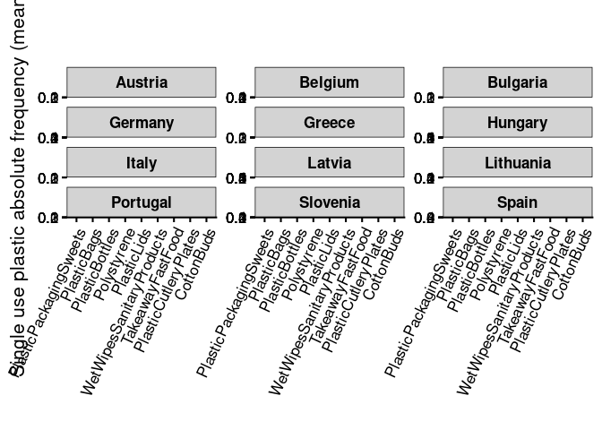<!-- -->

–\>

###### SUP Multivariate Perspective

In order to see if there are significant differences across country in
the community composition, we will perform a PERMANOVA test:

    ## Permutation test for adonis under reduced model
    ## Marginal effects of terms
    ## Permutation: free
    ## Number of permutations: 999
    ## 
    ## adonis2(formula = dist_mat_SUP ~ CountryResponsible, data = meta_SUP, permutations = 999, by = "margin")
    ##                     Df SumOfSqs      R2      F Pr(>F)    
    ## CountryResponsible  11   23.275 0.10276 5.3932  0.001 ***
    ## Residual           518  203.232 0.89724                  
    ## Total              529  226.507 1.00000                  
    ## ---
    ## Signif. codes:  0 '***' 0.001 '**' 0.01 '*' 0.05 '.' 0.1 ' ' 1

So, we conclude that there are significant differences among countries.
The R-Square value (0.103) means that the country “effects” explain
10.3% of the total variability. 89.7% is the remaining (unexplained)
variability among countries. ***There is a significant country effect,
but is small***.

Or even better: **There are statistically significant multivariate
differences in litter composition among countries, although the effect
size is modest (R² = 0.103).**

We can look for **heterocedasticity** among countries

    ## 
    ##  Homogeneity of multivariate dispersions
    ## 
    ## Call: betadisper(d = dist_mat_SUP, group = meta_SUP$CountryResponsible)
    ## 
    ## No. of Positive Eigenvalues: 9
    ## No. of Negative Eigenvalues: 0
    ## 
    ## Average distance to median:
    ##   austria   belgium  bulgaria   germany    greece   hungary     italy    latvia 
    ##    0.6174    0.5851    0.5416    0.5891    0.4907    0.5711    0.6384    0.4790 
    ## lithuania  portugal  slovenia     spain 
    ##    0.5726    0.6068    0.5959    0.6272 
    ## 
    ## Eigenvalues for PCoA axes:
    ## (Showing 8 of 9 eigenvalues)
    ##  PCoA1  PCoA2  PCoA3  PCoA4  PCoA5  PCoA6  PCoA7  PCoA8 
    ## 62.576 39.391 35.044 29.197 22.517 18.480 10.848  6.789

    ## 
    ## Permutation test for homogeneity of multivariate dispersions
    ## Permutation: free
    ## Number of permutations: 999
    ## 
    ## Response: Distances
    ##            Df  Sum Sq  Mean Sq      F N.Perm Pr(>F)  
    ## Groups     11  0.5355 0.048686 1.6889    999  0.071 .
    ## Residuals 518 14.9326 0.028827                       
    ## ---
    ## Signif. codes:  0 '***' 0.001 '**' 0.01 '*' 0.05 '.' 0.1 ' ' 1

The multivariate dispersion **does not differ significantly** among
countries (betadisper; F = 1.69, p = 0.071), so the PERMANOVA result
reflects differences in composition rather than in within-country
variability. There is a Country effect but it is small.

If we need to parametrize this model, we should use a Mixed Multivariate
Model (necessary?)

but What are the items that explains these differences?

The answer will be addressed by performing a **Multivariate Random
Forest**.

    ## 
    ## Call:
    ##  randomForest(x = comm_hel_SUP, y = as.factor(meta_SUP$CountryResponsible),      ntree = 500, importance = TRUE) 
    ##                Type of random forest: classification
    ##                      Number of trees: 500
    ## No. of variables tried at each split: 3
    ## 
    ##         OOB estimate of  error rate: 75.66%
    ## Confusion matrix:
    ##           austria belgium bulgaria germany greece hungary italy latvia
    ## austria        12       2        0      14      0       0     7      0
    ## belgium         3       3        1       9      0       0     3      0
    ## bulgaria        2       1        5       1      0       0     1      0
    ## germany         8       2        0      28      0       1     6      0
    ## greece          1       0        1       1      0       1     5      0
    ## hungary         1       1        1       1      0       3     3      0
    ## italy           6       3        0       6      1       2    17      0
    ## latvia          1       2        0       1      0       0     0      0
    ## lithuania       8      11        0      18      0       1     6      0
    ## portugal        7       2        0       6      0       0     5      0
    ## slovenia        5       1        0       2      1       0     4      0
    ## spain           9       9        1      18      0       1     9      0
    ##           lithuania portugal slovenia spain class.error
    ## austria          17        4        2    12   0.8285714
    ## belgium          14        3        0     8   0.9318182
    ## bulgaria          0        0        0     0   0.5000000
    ## germany          25        4        0     9   0.6626506
    ## greece            0        1        1     0   1.0000000
    ## hungary           3        2        0     0   0.8000000
    ## italy             4        0        2     9   0.6600000
    ## latvia            4        0        0     0   1.0000000
    ## lithuania        33        1        1     9   0.6250000
    ## portugal          8        6        1     8   0.8604651
    ## slovenia          5        4        1     1   0.9583333
    ## spain            12        1        3    21   0.7500000

Decisions have to be taken carefully since the prediction accuracy is
very low (0.24). Furthermore, the estimated error rate (OOB) is high, so
conclusion have to be taken with care.

Even though, the more important (differential across countries) litter
components are:

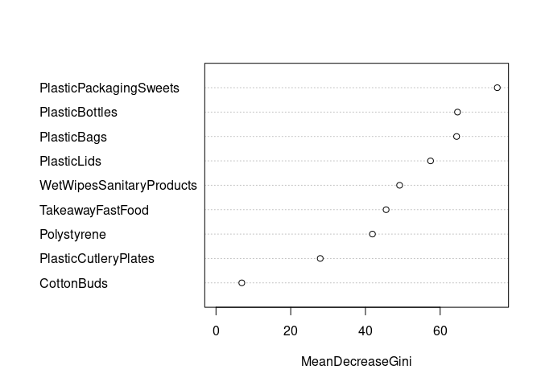<!-- -->

This plot of variable importance importance is telling us:

  - A large `MeanDecreaseAccuracy` (**MDA**) means that, when you break
    the relationship between that predictor and the response, the
    model’s accuracy suffers a lot → it’s an important predictor for
    correct country assignments.

  - **MDA** is generally the more reliable gauge of predictive
    importance, since it directly measures impact on OOB‐accuracy.

  - A large `MeanDecreaseGini` (**MDG**) means that X frequently appears
    in high‑up the tree splits and yields big purity gains → it’s
    structurally important to partitioning the data.
    
      - **MDG** is faster to compute and tells you which features the
        trees “prefer” splitting on, but can overweight high–cardinality
        or continuous variables.

Finally, we will perform a Principal Component Analysis (PCA) to see
correlation among litter items and *possible* associations with
countries

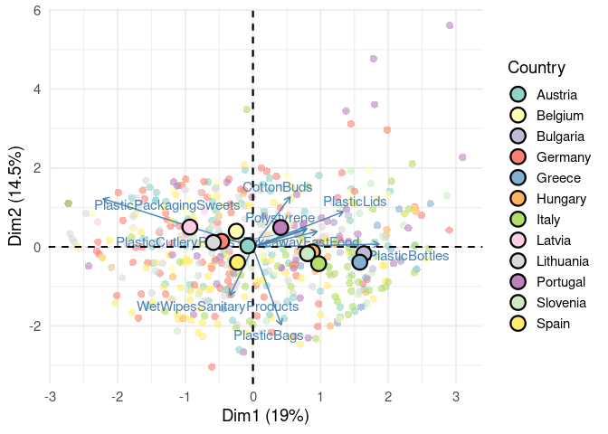<!-- -->

And the most important Items for the two forst principal components are:

  - First PC
    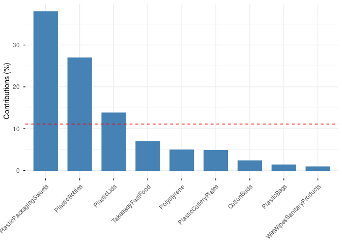<!-- -->

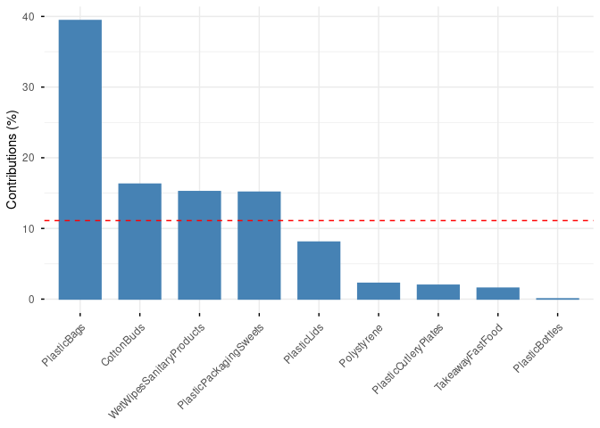<!-- -->

###### Manuscript values: Table 2 (PERMANOVA)

PERMANOVA results for the overall litter dataset (`perm1`) and the SUP
subset (`perm1_SUP`), in the layout of Table 2 of the manuscript.

    ##                    Analysis      Term  df      SS    F    R2 p_value
    ## 1          Overall analysis   Country  11  27.362 5.25 0.099   0.001
    ## 2          Overall analysis Residuals 526 249.052   NA 0.901      NA
    ## 3          Overall analysis     Total 537 276.414   NA 1.000      NA
    ## 4 Single-Use Plastics (SUP)   Country  11  23.275 5.39 0.103   0.001
    ## 5 Single-Use Plastics (SUP) Residuals 518 203.232   NA 0.897      NA
    ## 6 Single-Use Plastics (SUP)     Total 529 226.507   NA 1.000      NA

    ## # A tibble: 2 × 3
    ##   Analysis                      F p_value
    ##   <chr>                     <dbl>   <dbl>
    ## 1 Overall analysis           6.9    0.001
    ## 2 Single-Use Plastics (SUP)  1.69   0.071

## Floating DATA

### Data loading

    ## # A tibble: 375 × 15
    ##    DatasetID CountryResponsible SamplingYear SamplingAttempted DatasetQualified
    ##    <fct>     <chr>                     <dbl>             <dbl>            <dbl>
    ##  1 at_6270   Austria                    2022                 1                1
    ##  2 at_6297   Austria                    2022                 1                1
    ##  3 at_6349   Austria                    2022                 1                1
    ##  4 at_6372   Austria                    2022                 1                1
    ##  5 at_6382   Austria                    2022                 1                1
    ##  6 at_6393   Austria                    2022                 1                1
    ##  7 at_6414   Austria                    2022                 1                1
    ##  8 at_6448   Austria                    2022                 1                1
    ##  9 at_6703   Austria                    2023                 1                1
    ## 10 at_6718   Austria                    2023                 1                1
    ## # ℹ 365 more rows
    ## # ℹ 10 more variables: SamplingDate <date>, SamplingCoordinatesLatitude <dbl>,
    ## #   SamplingCoordinatesLongitude <dbl>, SamplingRiverSystem <fct>,
    ## #   FloatingMacro_AttemptedSampling <dbl>, FloatingMacro_Qualified <dbl>,
    ## #   FloatingMacro_ObservationTimeInMinutes <dbl>,
    ## #   FloatingMacro_RiverWidth <fct>, FloatingMacro_ObservedWidth <fct>,
    ## #   FloatingMacro_AmountOfFloatingMacrolitter <dbl>

#### Sampling Effor for Floating Data

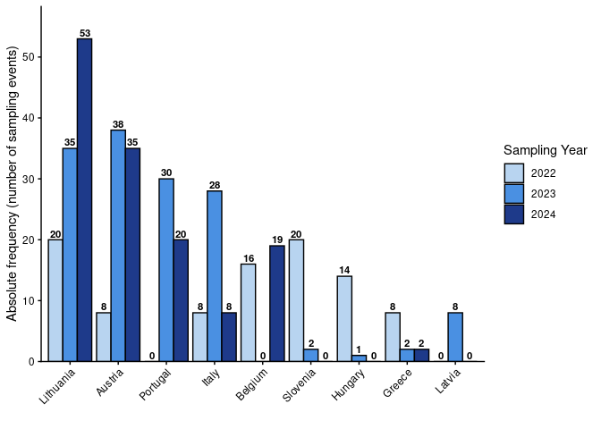<!-- -->

#### Macrolitter Flow calculation

The variable `FlowMacrolitter` is represented as the Number of floating
macrolitter \(m^{-1}\) \(h^{-1}\).

    ## # A tibble: 375 × 18
    ##    DatasetID CountryResponsible SamplingYear SamplingAttempted DatasetQualified
    ##    <fct>     <chr>                     <dbl>             <dbl>            <dbl>
    ##  1 at_6270   Austria                    2022                 1                1
    ##  2 at_6297   Austria                    2022                 1                1
    ##  3 at_6349   Austria                    2022                 1                1
    ##  4 at_6372   Austria                    2022                 1                1
    ##  5 at_6382   Austria                    2022                 1                1
    ##  6 at_6393   Austria                    2022                 1                1
    ##  7 at_6414   Austria                    2022                 1                1
    ##  8 at_6448   Austria                    2022                 1                1
    ##  9 at_6703   Austria                    2023                 1                1
    ## 10 at_6718   Austria                    2023                 1                1
    ## # ℹ 365 more rows
    ## # ℹ 13 more variables: SamplingDate <date>, SamplingCoordinatesLatitude <dbl>,
    ## #   SamplingCoordinatesLongitude <dbl>, SamplingRiverSystem <fct>,
    ## #   FloatingMacro_AttemptedSampling <dbl>, FloatingMacro_Qualified <dbl>,
    ## #   FloatingMacro_ObservationTimeInMinutes <dbl>,
    ## #   FloatingMacro_RiverWidth <fct>, FloatingMacro_ObservedWidth <fct>,
    ## #   FloatingMacro_AmountOfFloatingMacrolitter <dbl>, TimeInHours <dbl>, …

#### Macrolitter Flow Visualization

##### Differences across countries

Notes on the figures:

  - **All sampling years are always shown** for every country.
    Country-year combinations without valid data are labelled **n.d.**
    (no data). This covers both years without floating samplings and
    years where the flow could not be calculated (e.g. the river width
    is missing).
  - The number above each box is the number of valid samplings (*n*).
  - Most flow values are exactly 0, so the y-axis uses a **square-root
    scale**. This spreads out the small values near zero while keeping
    the zeros, which a log scale cannot show. All observations are drawn
    as points over the boxes.
  - No observations are removed from the plot. The previous version used
    `scale_y_continuous(limits = c(0, 1))`, which **dropped** the values
    above 1 before computing the boxplots.

<!-- end list -->

    ## # A tibble: 27 × 5
    ##    CountryResponsible SamplingYear n_samplings n_valid label
    ##    <chr>              <fct>              <int>   <int> <chr>
    ##  1 Austria            2022                   8       8 8    
    ##  2 Austria            2023                  38      36 36   
    ##  3 Austria            2024                  35      33 33   
    ##  4 Belgium            2022                  16       0 n.d. 
    ##  5 Belgium            2023                   0       0 n.d. 
    ##  6 Belgium            2024                  19      18 18   
    ##  7 Greece             2022                   8       8 8    
    ##  8 Greece             2023                   2       2 2    
    ##  9 Greece             2024                   2       1 1    
    ## 10 Hungary            2022                  14       8 8    
    ## # ℹ 17 more rows

  - Boxplots per country, with the sampling years nested within each
    country on the x-axis:

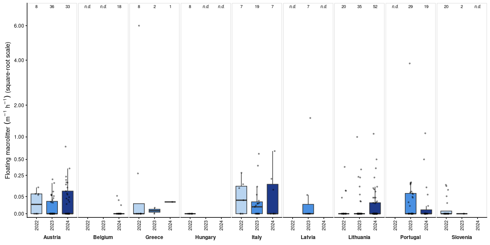<!-- -->

  - Same data with one panel per sampling year (`facet_grid`), to
    compare countries within each year:

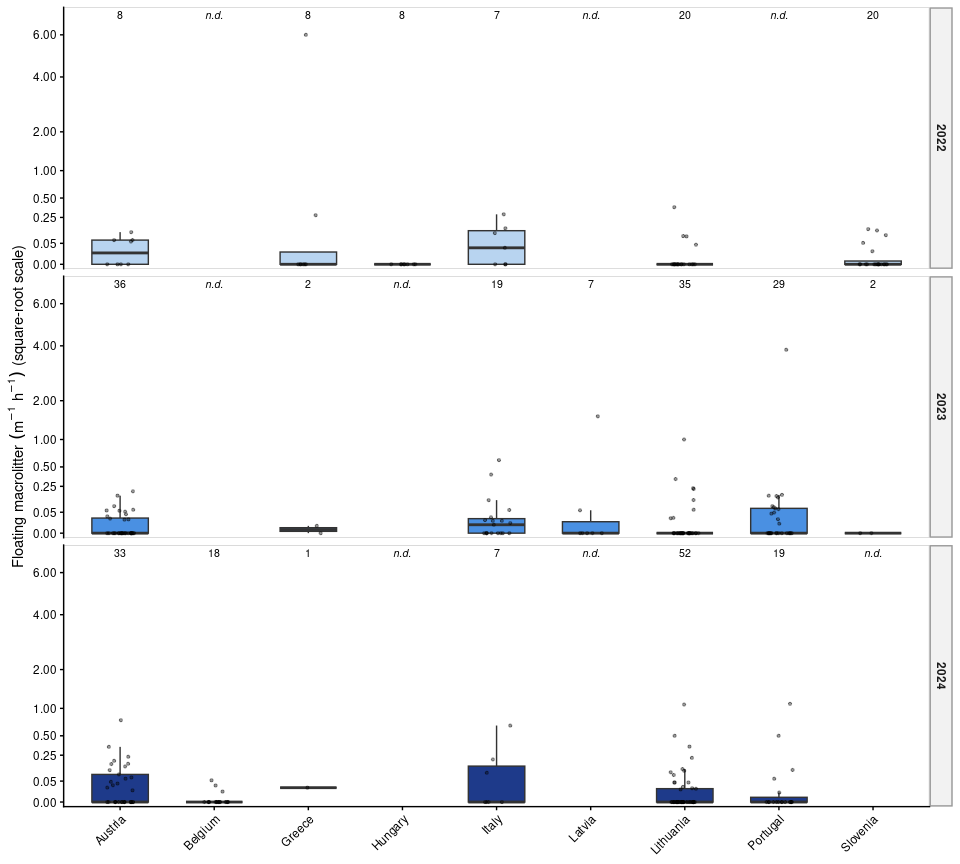<!-- -->

###### Manuscript values: low floating macrolitter densities

Summary of floating macrolitter flow (items m⁻¹ h⁻¹) per country,
pooling all years, to fill the sentence on the countries with low
densities (Belgium, Greece, Hungary and Latvia).

    ## # A tibble: 9 × 7
    ##   CountryResponsible     n Median  Mean    SE   Q75   Max
    ##   <chr>              <int>  <dbl> <dbl> <dbl> <dbl> <dbl>
    ## 1 Austria               77  0     0.047 0.012 0.059 0.764
    ## 2 Belgium               18  0     0.005 0.003 0     0.054
    ## 3 Greece                11  0     0.573 0.543 0.015 6    
    ## 4 Hungary                8  0     0     0     0     0    
    ## 5 Italy                 33  0.008 0.086 0.029 0.098 0.667
    ## 6 Latvia                 7  0     0.231 0.221 0.03  1.56 
    ## 7 Lithuania            107  0     0.051 0.016 0.009 1.08 
    ## 8 Portugal              48  0     0.139 0.083 0.063 3.83 
    ## 9 Slovenia              22  0     0.02  0.009 0     0.141

    ## # A tibble: 6 × 5
    ##   CountryResponsible SamplingYear     n Median   Max
    ##   <chr>              <fct>        <int>  <dbl> <dbl>
    ## 1 Belgium            2024            18  0     0.054
    ## 2 Greece             2022             8  0     6    
    ## 3 Greece             2023             2  0.003 0.006
    ## 4 Greece             2024             1  0.024 0.024
    ## 5 Hungary            2022             8  0     0    
    ## 6 Latvia             2023             7  0     1.56

  - **Statistical test**
    
      - Generalize linear mixed model (Tweedie)
    
    Family error distribution was selected due to the data restriction
    (only positive values with high numbers of zeroes)

<!-- end list -->

    ##  Family: tweedie  ( log )
    ## Formula:          FlowMacrolitter ~ CountryResponsible
    ## Data: FlowData
    ## 
    ##       AIC       BIC    logLik -2*log(L)  df.resid 
    ##     290.0     331.8    -134.0     268.0       320 
    ## 
    ## 
    ## Dispersion parameter for tweedie family (): 2.16 
    ## 
    ## Conditional model:
    ##                               Estimate Std. Error z value Pr(>|z|)    
    ## (Intercept)                    -3.0551     0.3049 -10.018  < 2e-16 ***
    ## CountryResponsibleBelgium      -2.1601     1.0099  -2.139   0.0324 *  
    ## CountryResponsibleGreece        2.4984     0.5812   4.299 1.72e-05 ***
    ## CountryResponsibleHungary     -49.0697 22469.0664  -0.002   0.9983    
    ## CountryResponsibleItaly         0.6001     0.5143   1.167   0.2433    
    ## CountryResponsibleLatvia        1.5887     0.8014   1.982   0.0474 *  
    ## CountryResponsibleLithuania     0.0708     0.3976   0.178   0.8587    
    ## CountryResponsiblePortugal      1.0816     0.4367   2.477   0.0132 *  
    ## CountryResponsibleSlovenia     -0.8575     0.7405  -1.158   0.2469    
    ## ---
    ## Signif. codes:  0 '***' 0.001 '**' 0.01 '*' 0.05 '.' 0.1 ' ' 1

    ## Data: FlowData
    ## Models:
    ## mod_null: FlowMacrolitter ~ 1, zi=~0, disp=~1
    ## mod_full: FlowMacrolitter ~ CountryResponsible, zi=~0, disp=~1
    ##          Df    AIC    BIC  logLik deviance  Chisq Chi Df Pr(>Chisq)    
    ## mod_null  3 318.27 329.68 -156.14   312.27                             
    ## mod_full 11 290.01 331.83 -134.00   268.01 44.266      8  5.068e-07 ***
    ## ---
    ## Signif. codes:  0 '***' 0.001 '**' 0.01 '*' 0.05 '.' 0.1 ' ' 1

  - Posthoc with multple comparisons

<!-- end list -->

    ##  contrast                ratio       SE  df null z.ratio p.value
    ##  Austria / Belgium    9.00e+00 9.00e+00 Inf    1   2.139  0.4464
    ##  Austria / Greece     0.00e+00 0.00e+00 Inf    1  -4.299  0.0006
    ##  Austria / Hungary    2.05e+21 4.60e+25 Inf    1   0.002  1.0000
    ##  Austria / Italy      1.00e+00 0.00e+00 Inf    1  -1.167  0.9634
    ##  Austria / Latvia     0.00e+00 0.00e+00 Inf    1  -1.982  0.5557
    ##  Austria / Lithuania  1.00e+00 0.00e+00 Inf    1  -0.178  1.0000
    ##  Austria / Portugal   0.00e+00 0.00e+00 Inf    1  -2.477  0.2431
    ##  Austria / Slovenia   2.00e+00 2.00e+00 Inf    1   1.158  0.9650
    ##  Belgium / Greece     0.00e+00 0.00e+00 Inf    1  -4.304  0.0006
    ##  Belgium / Hungary    2.36e+20 5.30e+24 Inf    1   0.002  1.0000
    ##  Belgium / Italy      0.00e+00 0.00e+00 Inf    1  -2.634  0.1726
    ##  Belgium / Latvia     0.00e+00 0.00e+00 Inf    1  -3.086  0.0524
    ##  Belgium / Lithuania  0.00e+00 0.00e+00 Inf    1  -2.240  0.3795
    ##  Belgium / Portugal   0.00e+00 0.00e+00 Inf    1  -3.203  0.0368
    ##  Belgium / Slovenia   0.00e+00 0.00e+00 Inf    1  -1.108  0.9732
    ##  Greece / Hungary     2.49e+22 5.59e+26 Inf    1   0.002  1.0000
    ##  Greece / Italy       7.00e+00 4.00e+00 Inf    1   2.942  0.0790
    ##  Greece / Latvia      2.00e+00 2.00e+00 Inf    1   1.021  0.9840
    ##  Greece / Lithuania   1.10e+01 6.00e+00 Inf    1   4.361  0.0004
    ##  Greece / Portugal    4.00e+00 2.00e+00 Inf    1   2.421  0.2722
    ##  Greece / Slovenia    2.90e+01 2.40e+01 Inf    1   4.011  0.0020
    ##  Hungary / Italy      0.00e+00 0.00e+00 Inf    1  -0.002  1.0000
    ##  Hungary / Latvia     0.00e+00 0.00e+00 Inf    1  -0.002  1.0000
    ##  Hungary / Lithuania  0.00e+00 0.00e+00 Inf    1  -0.002  1.0000
    ##  Hungary / Portugal   0.00e+00 0.00e+00 Inf    1  -0.002  1.0000
    ##  Hungary / Slovenia   0.00e+00 0.00e+00 Inf    1  -0.002  1.0000
    ##  Italy / Latvia       0.00e+00 0.00e+00 Inf    1  -1.164  0.9638
    ##  Italy / Lithuania    2.00e+00 1.00e+00 Inf    1   1.088  0.9761
    ##  Italy / Portugal     1.00e+00 0.00e+00 Inf    1  -0.928  0.9914
    ##  Italy / Slovenia     4.00e+00 3.00e+00 Inf    1   1.841  0.6547
    ##  Latvia / Lithuania   5.00e+00 4.00e+00 Inf    1   1.937  0.5880
    ##  Latvia / Portugal    2.00e+00 1.00e+00 Inf    1   0.630  0.9994
    ##  Latvia / Slovenia    1.20e+01 1.20e+01 Inf    1   2.441  0.2618
    ##  Lithuania / Portugal 0.00e+00 0.00e+00 Inf    1  -2.505  0.2291
    ##  Lithuania / Slovenia 3.00e+00 2.00e+00 Inf    1   1.287  0.9355
    ##  Portugal / Slovenia  7.00e+00 5.00e+00 Inf    1   2.608  0.1832
    ## 
    ## P value adjustment: tukey method for comparing a family of 9 estimates 
    ## Tests are performed on the log scale
