**Density version.** This document repeats all the analyses of
`Plastic_Pirates_EU_Analysis.Rmd`, but every Riverside (Group B) litter
count is standardised by the searched area and expressed as
**items/m²**. The area of each sampling is length × width of the
riverbank searched. Samplings with a missing length or width, a searched
length above 1000 m, or a zero area are removed completely. The Floating
data section is unchanged.

# Data Analysis

## Loading Packages

Loading R packages necessary to perform the **EDA**.

## Data loading

## Pre-proccessing

## RESEARCH QUESTIONS

### Citizens Description

#### Numer of samplings per year and country

- Table

<!-- -->

    ## # A tibble: 28 × 3
    ## # Groups:   CountryResponsible [12]
    ##    CountryResponsible SamplingYear Num_Sampling
    ##    <chr>                     <int>        <int>
    ##  1 austria                    2022           13
    ##  2 austria                    2023           54
    ##  3 austria                    2024           62
    ##  4 belgium                    2022           22
    ##  5 belgium                    2024           31
    ##  6 bulgaria                   2023           10
    ##  7 germany                    2022           73
    ##  8 germany                    2023           11
    ##  9 germany                    2024            6
    ## 10 greece                     2022            8
    ## # ℹ 18 more rows

- Plot

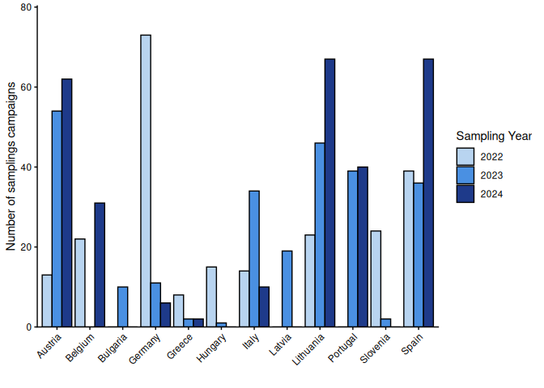<!-- -->

#### Numer of Rivers sampled per year and country

- Table

<!-- -->

    ## # A tibble: 28 × 3
    ## # Groups:   CountryResponsible [12]
    ##    CountryResponsible SamplingYear Rivers
    ##    <chr>                     <int>  <int>
    ##  1 austria                    2022     10
    ##  2 austria                    2023     35
    ##  3 austria                    2024     35
    ##  4 belgium                    2022     12
    ##  5 belgium                    2024     18
    ##  6 bulgaria                   2023      1
    ##  7 germany                    2022     58
    ##  8 germany                    2023     10
    ##  9 germany                    2024      5
    ## 10 greece                     2022      7
    ## # ℹ 18 more rows

- Plot (without numbers)

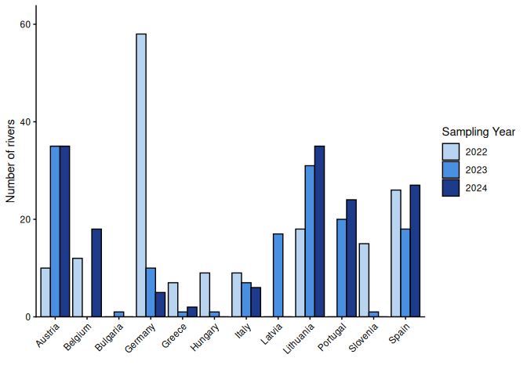<!-- -->

- Plot (with numbers)

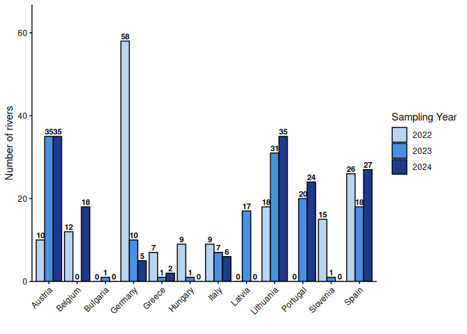<!-- -->

Crearemos una sola figura con las dos gráficas.

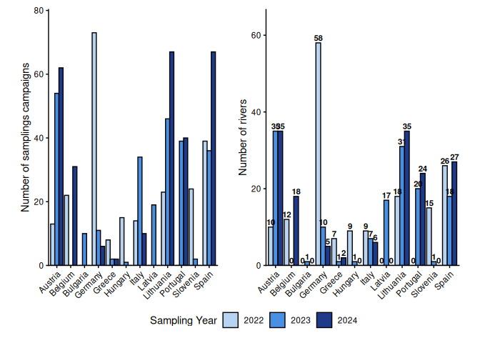<!-- -->

### Sampling Effort Description

The sampling effort of each Group B survey is defined by the size of the
riverbank area searched, recorded in two attributes:

- `RiversideWasteVariety_Results_LengthOfRiverbankSearchedM`: length of
  the riverbank searched (m).
- `RiversideWasteVariety_Results_WidthOfRiverbankSearchedM`: width of
  the riverbank searched (m).

According to the dataset documentation
(`READme_info_riverbank_v2.0.0.txt`), *“Data for length and width of
riverbank searched for group B could not always be verified by the
experts”*. Therefore, before using them (e.g. to standardise litter
counts per m²), we describe (i) the amount of missing values and (ii)
their variability, looking for outliers.

**Note:** the CSV codes missing values both as `"na"` and as `"NA"`.
Both are declared as missing in `DataLoading`
(`na.strings = c("na", "NA")`), so length and width are read as numeric.
Otherwise, the width attribute would be read as text because of the
literal `"NA"` cells.

#### Missing values

For each attribute we count the missing values (`NA`), and for the
combination of both we count the *complete cases* (rows with both length
and width). The *Incomplete* columns show how many records, and what
percentage of the total, would be removed if we kept only complete
cases. This is shown for the whole dataset, for the attempted samplings
and for the validated Group B samplings (the subset used in the
analyses).

    ##                Subset   N NA Length (n) NA Length (%) NA Width (n) NA Width (%)
    ## 1         All records 770            84          10.9           82         10.6
    ## 2  Attempted sampling 742            56           7.5           54          7.3
    ## 3 Validated (Group B) 545             8           1.5           14          2.6
    ##   NA Both (n) Incomplete (n) Incomplete (%) Complete cases (n)
    ## 1          74             92           11.9                678
    ## 2          46             64            8.6                678
    ## 3           7             15            2.8                530
    ##   Complete cases (%)
    ## 1               88.1
    ## 2               91.4
    ## 3               97.2

In the validated Group B dataset, 15 out of 545 samplings (2.8%) lack
the length, the width or both. Keeping only complete cases would remove
that share of the data.

Missing values per country (validated Group B samplings), to check
whether they are concentrated in a few countries:

    ## # A tibble: 12 × 6
    ##    CountryResponsible     N `NA Length (n)` `NA Width (n)` `Incomplete (n)`
    ##    <chr>              <int>           <int>          <int>            <int>
    ##  1 Italy                 51               2              5                5
    ##  2 Slovenia              24               1              1                2
    ##  3 Portugal              45               2              3                3
    ##  4 Germany               84               1              3                3
    ##  5 Spain                 86               2              2                2
    ##  6 Austria               70               0              0                0
    ##  7 Belgium               49               0              0                0
    ##  8 Bulgaria              10               0              0                0
    ##  9 Greece                11               0              0                0
    ## 10 Hungary               15               0              0                0
    ## 11 Latvia                10               0              0                0
    ## 12 Lithuania             90               0              0                0
    ## # ℹ 1 more variable: `Incomplete (%)` <dbl>

#### Variability and outliers

Descriptive statistics of the validated Group B samplings. Zero values
are also counted, since a searched length or width of 0 m is not
plausible.

Both attributes are strongly concentrated around a few “standard” values
(most samplings searched about 50 m × 20 m) and have long right tails.
Under these conditions Tukey’s IQR rule is not useful: the width IQR is
very narrow (15–20 m), so the rule flags around a quarter of the
samplings as outliers, even on a log scale. Instead, we flag as
**extreme values** those below the lower or above the upper percentile
set in `pct_limits` (by default the 1st and 99th percentiles), plus all
zero values. The limits can be changed to make the criterion more or
less strict.

    ## # A tibble: 3 × 13
    ##   Variable     n  `NA` Zeros   Min P_low    Q1 Median   Mean    Q3 P_high    Max
    ##   <fct>    <int> <int> <int> <dbl> <dbl> <dbl>  <dbl>  <dbl> <dbl>  <dbl>  <dbl>
    ## 1 Length_m   537     8     2     0  7.21    40     50   91.4    85   700  1.37e3
    ## 2 Width_m    531    14     2     0  2       15     20   24.3    20   100  1.5 e3
    ## 3 Area_m2    530    15     2     0 36.7    600   1000 4287.   1600 16988. 1.05e6
    ## # ℹ 1 more variable: `Extreme (n)` <int>

Both attributes are strongly right-skewed (the mean is much higher than
the median), so the histograms use a logarithmic x-axis. Zero values
cannot be shown on a log scale and are excluded from the plots (they are
counted in the table above). The solid line marks the median and the
dashed lines the percentile limits. The scatter plot combines both
attributes; the grey diagonal lines show constant searched areas (100,
1,000, 10,000 and 100,000 m²).

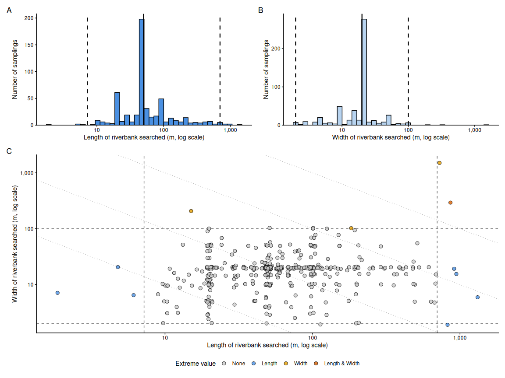<!-- -->

Distribution of length and width per country, to check whether outliers
are specific to some countries (zero values excluded):

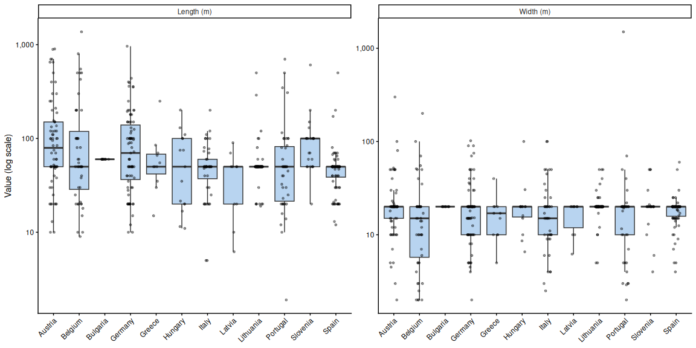<!-- -->

List of the validated samplings with extreme values (outside the
percentile limits, or zero) in length or width, ordered by searched
area, for manual checking:

    ##    DatasetID CountryResponsible SamplingYear   SamplingRiver Length_m Width_m
    ## 1    pt_6762           Portugal         2023    Pinhão River    700.0  1500.0
    ## 2    at_6953            Austria         2023      Halterbach    900.0   300.0
    ## 3    de_6249            Germany         2022    Lauter River    180.0   102.0
    ## 4    at_7163            Austria         2024            Ager    890.0    20.0
    ## 5    de_6326            Germany         2022     Hunte River    962.0    15.0
    ## 6    be_6325            Belgium         2022   Scheldt River   1370.0     6.0
    ## 7    be_7292            Belgium         2024     Kleine Nete     15.0   200.0
    ## 8    be_6444            Belgium         2022      Yser River    800.0     2.0
    ## 9    it_6572              Italy         2022     Tiber River      5.0    20.0
    ## 10   lv_7074             Latvia         2023           Vaive      6.2     6.2
    ## 11   pt_6608           Portugal         2023 Carenque Stream      1.9     7.0
    ## 12   be_6516            Belgium         2022    Dommel River      0.0     0.0
    ## 13   it_7104              Italy         2023     Tiber River      0.0     0.0
    ## 14   it_6552              Italy         2022     Carabollace      5.0      NA
    ##      Area_m2        Extreme
    ## 1  1.050e+06          Width
    ## 2  2.700e+05 Length & Width
    ## 3  1.836e+04          Width
    ## 4  1.780e+04         Length
    ## 5  1.443e+04         Length
    ## 6  8.220e+03         Length
    ## 7  3.000e+03          Width
    ## 8  1.600e+03         Length
    ## 9  1.000e+02         Length
    ## 10 3.844e+01         Length
    ## 11 1.330e+01         Length
    ## 12 0.000e+00 Length & Width
    ## 13 0.000e+00 Length & Width
    ## 14        NA         Length

#### Area filter for density (items/m²)

To express the litter counts as densities, each validated Group B
sampling is divided by its searched area
(`Area_m2 = Length_m × Width_m`). Samplings are removed completely when:

- the length or the width is missing (`NA`);
- the searched length is above 1000 m (`max_length_m`), or the width is
  above `max_width_m` (no limit by default);
- the area is 0 (a length or width of 0 m), because the density cannot
  be calculated.

<!-- -->

    ##                    Reason Samplings
    ## 1                    Kept       527
    ## 2         Length > 1000 m         1
    ## 3 Missing length or width        15
    ## 4               Zero area         2

    ##    DatasetID CountryResponsible SamplingYear     SamplingRiver Length_m Width_m
    ## 1    be_6325            Belgium         2022     Scheldt River     1370       6
    ## 2    de_6498            Germany         2022        Hase River      100      NA
    ## 3    de_6250            Germany         2022      Wupper River      100      NA
    ## 4    de_7044            Germany         2023        Elbe River       NA      NA
    ## 5    it_6555              Italy         2022              Mela       50      NA
    ## 6    it_6554              Italy         2022         Magazzolo       20      NA
    ## 7    it_6552              Italy         2022       Carabollace        5      NA
    ## 8    it_7193              Italy         2023       Tiber River       NA      NA
    ## 9    it_6771              Italy         2023       Tiber River       NA      NA
    ## 10   pt_7084           Portugal         2023       Tinto River       30      NA
    ## 11   pt_7306           Portugal         2024   Alportel Stream       NA      NA
    ## 12   pt_7392           Portugal         2024       Tagus River       NA      NA
    ## 13   si_6238           Slovenia         2022 Ljubljanica River       NA      20
    ## 14  si_6426b           Slovenia         2022        Sava River       20      NA
    ## 15   sp_6390              Spain         2022    Cardener River       NA      NA
    ## 16   sp_7242              Spain         2024       Anoia River       NA      NA
    ## 17   be_6516            Belgium         2022      Dommel River        0       0
    ## 18   it_7104              Italy         2023       Tiber River        0       0
    ##    Area_m2                  Reason
    ## 1     8220         Length > 1000 m
    ## 2       NA Missing length or width
    ## 3       NA Missing length or width
    ## 4       NA Missing length or width
    ## 5       NA Missing length or width
    ## 6       NA Missing length or width
    ## 7       NA Missing length or width
    ## 8       NA Missing length or width
    ## 9       NA Missing length or width
    ## 10      NA Missing length or width
    ## 11      NA Missing length or width
    ## 12      NA Missing length or width
    ## 13      NA Missing length or width
    ## 14      NA Missing length or width
    ## 15      NA Missing length or width
    ## 16      NA Missing length or width
    ## 17       0               Zero area
    ## 18       0               Zero area

Validated Group B samplings kept per country after the area filter:

    ## # A tibble: 12 × 5
    ##    CountryResponsible Validated  Kept Removed `Removed (%)`
    ##    <chr>                  <int> <int>   <int>         <dbl>
    ##  1 Austria                   70    70       0           0  
    ##  2 Belgium                   49    47       2           4.1
    ##  3 Bulgaria                  10    10       0           0  
    ##  4 Germany                   84    81       3           3.6
    ##  5 Greece                    11    11       0           0  
    ##  6 Hungary                   15    15       0           0  
    ##  7 Italy                     51    45       6          11.8
    ##  8 Latvia                    10    10       0           0  
    ##  9 Lithuania                 90    90       0           0  
    ## 10 Portugal                  45    42       3           6.7
    ## 11 Slovenia                  24    22       2           8.3
    ## 12 Spain                     86    84       2           2.3

Out of 545 validated Group B samplings, 527 are kept and 18 are removed.
The sampling description above (campaigns, rivers and validation rates)
uses all records, because it does not depend on the litter counts.

### Most common types and quantities of litter per region? (Group B: riverbanks; Group C: floating litter)

#### Group B: Riverside Waste

Statistics of the variable `RiversideWasteVariety_AttemptedSampling` to
see how many samplings were performed.

    ## RiversideWasteVariety_AttemptedSampling
    ##   0   1 
    ##  26 742

To work with the `RiversideWasteVariety_` data, we need to filter the
dataset to include only those rows where
`RiversideWasteVariety_AttemptedSampling` is 1 (indicating that a
sampling was attempted) and `RiversideWasteVariety_Qualified` is also 1
(indicating that the sampling was qualified).

##### Percentage of qualified samplings

This represents the percentage of validated data among the total number
of sampling beign attempted.

    ##   total_rows total_valid pct_valid_total pct_valid_percent
    ## 1        770         545            70.8             70.8%

    ## # A tibble: 12 × 7
    ##    CountryResponsible total_rows total_valid `pct_valid_total(%)` total_attempts
    ##    <chr>                   <int>       <int>                <dbl>          <int>
    ##  1 Austria                   129          70                 54.3            116
    ##  2 Belgium                    53          49                 92.5             52
    ##  3 Bulgaria                   10          10                100               10
    ##  4 Germany                    90          84                 93.3             89
    ##  5 Greece                     12          11                 91.7             11
    ##  6 Hungary                    16          15                 93.8             16
    ##  7 Italy                      58          51                 87.9             55
    ##  8 Latvia                     19          10                 52.6             19
    ##  9 Lithuania                 136          90                 66.2            133
    ## 10 Portugal                   79          45                 57               77
    ## 11 Slovenia                   26          24                 92.3             25
    ## 12 Spain                     142          86                 60.6            139
    ## # ℹ 2 more variables: valid_among_attempts <int>,
    ## #   `pct_valid_among_attempts(%)` <dbl>

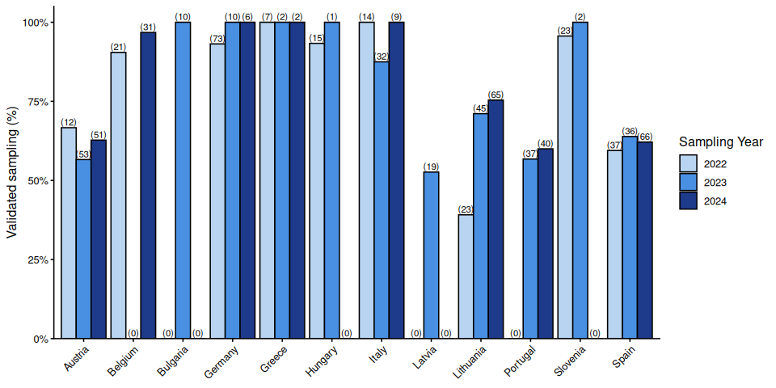<!-- -->

###### Manuscript values: validation rates (Sampling Effort)

Validation rate (% of attempted Group B samplings that were validated)
per country and year, as in Fig. 2C, and the lowest rate among the
countries described in the manuscript as having high validation rates.

    ## # A tibble: 12 × 4
    ##    CountryResponsible `2022` `2023` `2024`
    ##    <chr>               <dbl>  <dbl>  <dbl>
    ##  1 Austria              66.7   56.6   62.7
    ##  2 Belgium              90.5   NA     96.8
    ##  3 Bulgaria             NA    100     NA  
    ##  4 Germany              93.2  100    100  
    ##  5 Greece              100    100    100  
    ##  6 Hungary              93.3  100     NA  
    ##  7 Italy               100     87.5  100  
    ##  8 Latvia               NA     52.6   NA  
    ##  9 Lithuania            39.1   71.1   75.4
    ## 10 Portugal             NA     56.8   60  
    ## 11 Slovenia             95.7  100     NA  
    ## 12 Spain                59.5   63.9   62.1

    ## # A tibble: 5 × 5
    ##   CountryResponsible SamplingYear n_attempted n_validated pct_validated
    ##   <chr>                     <int>       <int>       <int>         <dbl>
    ## 1 Italy                      2023          32          28          87.5
    ## 2 Belgium                    2022          21          19          90.5
    ## 3 Germany                    2022          73          68          93.2
    ## 4 Hungary                    2022          15          14          93.3
    ## 5 Slovenia                   2022          23          22          95.7

##### Most common types/quantities of litter

Firstly, we will pick up data to answer the question about group B. Only
some variables are taken from the general dataset.

The, Attributes’ names are so complicated to work that I’ll remote the
preceding information **RiversideWasteVariety_Results\_** which is
common to all attributes; and finally to work with only the validated
`Group B` dataset we create:

**CAUTION**! There are some `NAs` values in the litter items that are
probably incorrect since the groups did find other items.

After meeting and email from Charlotte, we realise that NA in group B
for some items it’s really a zero. So we update these columns replacing
`NA` values with a `0`.

**Standardisation to density (items/m²).** We keep only the samplings
that passed the area filter (`AreaFilter` chunk) and divide every litter
count by the searched area. From here on, all Group B values
(`PlasticBags` … `LocalWaste`) are densities in items/m².

    ## [1] 527

    ##      Min.   1st Qu.    Median      Mean   3rd Qu.      Max. 
    ##      13.3     600.0    1000.0    4295.4    1600.0 1050000.0

###### Litter type density (items/m²)

We will obtain the plot for the most common (average density, items/m²)
litter type, as a table and then as a plot.

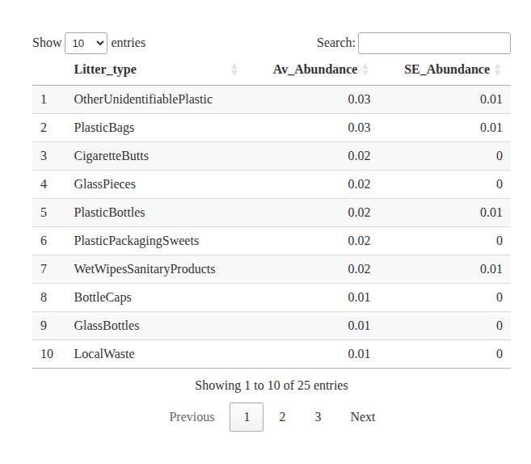<!-- -->

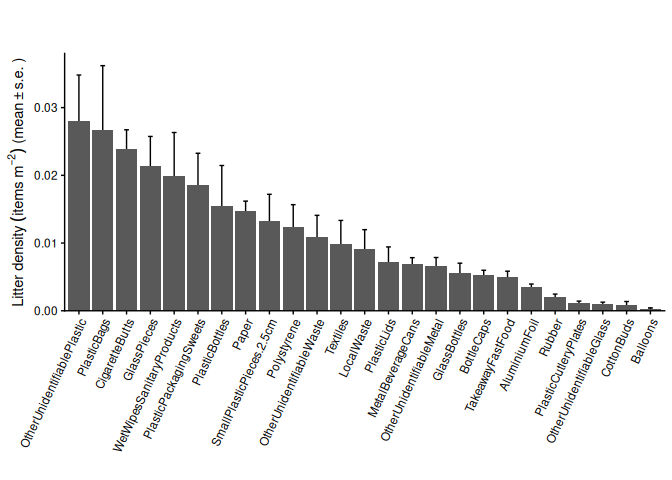<!-- -->

###### Litter type density per country

If we now want to visualize the contribution per each country, we have:

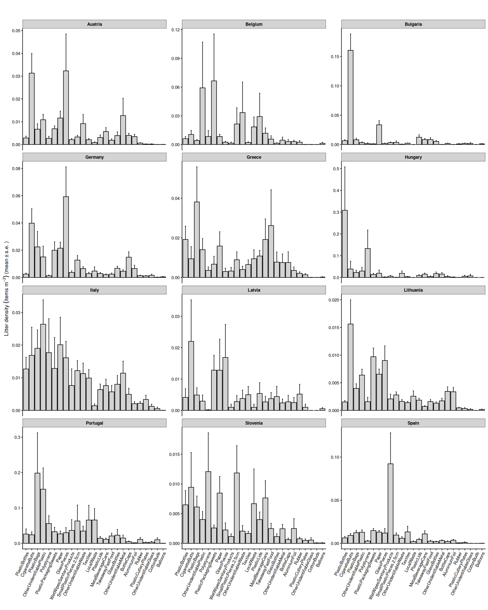<!-- -->

###### Manuscript values: mean ± s.e. and n (Fig. 3 and Fig. 4)

Mean ± standard error (items/m², four decimals) and number of validated
samplings (*n*) for the litter categories and countries cited in the
Results section.

    ## # A tibble: 4 × 5
    ##   Litter_type                    n   Mean      SE Manuscript              
    ##   <chr>                      <int>  <dbl>   <dbl> <chr>                   
    ## 1 OtherUnidentifiablePlastic   527 0.0280 0.00676 0.0280 ± 0.0068, n = 527
    ## 2 PlasticBags                  527 0.0267 0.00944 0.0267 ± 0.0094, n = 527
    ## 3 CigaretteButts               527 0.0239 0.00283 0.0239 ± 0.0028, n = 527
    ## 4 GlassPieces                  527 0.0214 0.00434 0.0214 ± 0.0043, n = 527

    ## # A tibble: 16 × 3
    ##    Litter_type                CountryResponsible Manuscript             
    ##    <chr>                      <chr>              <chr>                  
    ##  1 CigaretteButts             Bulgaria           0.1605 ± 0.0279, n = 10
    ##  2 CigaretteButts             Austria            0.0313 ± 0.0086, n = 70
    ##  3 CigaretteButts             Germany            0.0398 ± 0.0107, n = 81
    ##  4 CigaretteButts             Lithuania          0.0156 ± 0.0044, n = 90
    ##  5 GlassPieces                Austria            0.0323 ± 0.0162, n = 70
    ##  6 GlassPieces                Germany            0.0593 ± 0.0218, n = 81
    ##  7 GlassPieces                Italy              0.0161 ± 0.0051, n = 45
    ##  8 GlassPieces                Portugal           0.0302 ± 0.0144, n = 42
    ##  9 GlassPieces                Lithuania          0.0090 ± 0.0027, n = 90
    ## 10 PlasticBottles             Hungary            0.3085 ± 0.1992, n = 15
    ## 11 PlasticBottles             Greece             0.0192 ± 0.0067, n = 11
    ## 12 PlasticBags                Greece             0.0381 ± 0.0177, n = 11
    ## 13 Polystyrene                Slovenia           0.0121 ± 0.0065, n = 22
    ## 14 WetWipesSanitaryProducts   Spain              0.0922 ± 0.0359, n = 84
    ## 15 PlasticPackagingSweets     Belgium            0.0665 ± 0.0490, n = 47
    ## 16 OtherUnidentifiablePlastic Belgium            0.0592 ± 0.0478, n = 47

###### Litter type Proportion I - “Across‑type” proportions

- The first approach will be a “*Across‑type*” proportions.
  - For each litter type, what fraction comes from each country? (not
    from an european total)
  - total abundance of that litter type over each total country.

<!-- -->

    ## # A tibble: 300 × 5
    ##    CountryResponsible Litter_type      Total_Abundance Global_Total Prop_Country
    ##    <chr>              <chr>                      <dbl>        <dbl>        <dbl>
    ##  1 austria            AluminiumFoil            0.243          1.83       0.133  
    ##  2 austria            Balloons                 0.00360        0.171      0.0211 
    ##  3 austria            BottleCaps               0.281          2.76       0.102  
    ##  4 austria            CigaretteButts           2.19          12.6        0.174  
    ##  5 austria            CottonBuds               0.00184        0.479      0.00384
    ##  6 austria            GlassBottles             0.275          2.97       0.0925 
    ##  7 austria            GlassPieces              2.26          11.3        0.200  
    ##  8 austria            LocalWaste               0.0581         4.81       0.0121 
    ##  9 austria            MetalBeverageCa…         0.397          3.64       0.109  
    ## 10 austria            OtherUnidentifi…         0.0114         0.503      0.0227 
    ## # ℹ 290 more rows

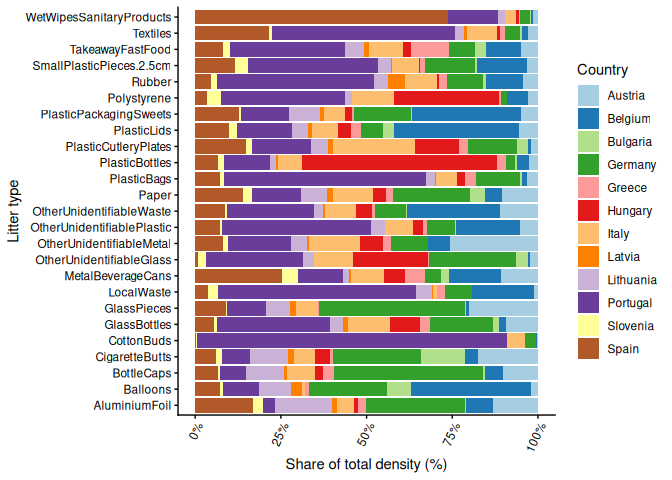<!-- -->

- Now, considering the total of Europe

<!-- -->

    ## # A tibble: 300 × 5
    ##    CountryResponsible Litter_type  Total_Abundance European_Total Prop_of_Europe
    ##    <chr>              <fct>                  <dbl>          <dbl>          <dbl>
    ##  1 Austria            AluminiumFo…         0.243            1.83         0.133  
    ##  2 Austria            Balloons             0.00360          0.171        0.0211 
    ##  3 Austria            BottleCaps           0.281            2.76         0.102  
    ##  4 Austria            CigaretteBu…         2.19            12.6          0.174  
    ##  5 Austria            CottonBuds           0.00184          0.479        0.00384
    ##  6 Austria            GlassBottles         0.275            2.97         0.0925 
    ##  7 Austria            GlassPieces          2.26            11.3          0.200  
    ##  8 Austria            LocalWaste           0.0581           4.81         0.0121 
    ##  9 Austria            MetalBevera…         0.397            3.64         0.109  
    ## 10 Austria            OtherUniden…         0.0114           0.503        0.0227 
    ## # ℹ 290 more rows

To compare and validate the output, for each `litter_type` the
`European_Total` have to be the same.

    ## # A tibble: 12 × 5
    ##    CountryResponsible Litter_type  Total_Abundance European_Total Prop_of_Europe
    ##    <chr>              <fct>                  <dbl>          <dbl>          <dbl>
    ##  1 Austria            AluminiumFo…        0.243              1.83       0.133   
    ##  2 Belgium            AluminiumFo…        0.144              1.83       0.0786  
    ##  3 Bulgaria           AluminiumFo…        0.000833           1.83       0.000455
    ##  4 Germany            AluminiumFo…        0.534              1.83       0.291   
    ##  5 Greece             AluminiumFo…        0.0391             1.83       0.0213  
    ##  6 Hungary            AluminiumFo…        0.0229             1.83       0.0125  
    ##  7 Italy              AluminiumFo…        0.0928             1.83       0.0507  
    ##  8 Latvia             AluminiumFo…        0.0251             1.83       0.0137  
    ##  9 Lithuania          AluminiumFo…        0.303              1.83       0.166   
    ## 10 Portugal           AluminiumFo…        0.0658             1.83       0.0359  
    ## 11 Slovenia           AluminiumFo…        0.0548             1.83       0.0299  
    ## 12 Spain              AluminiumFo…        0.307              1.83       0.167

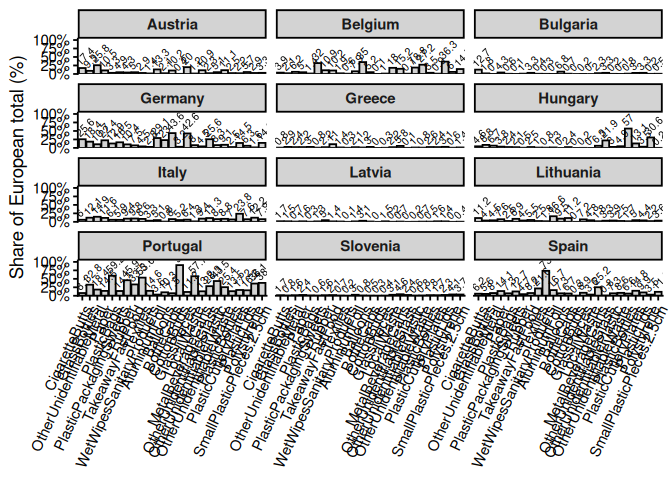

- HeatMaps

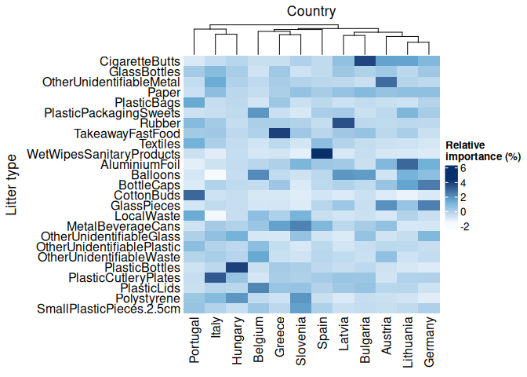

Bootstrap implementation in the dendrograms nodes. It replaces the
previous heatmap with the dendrograms based on bootstrap values.

    ## Bootstrap (r = 0.48)... Done.
    ## Bootstrap (r = 0.6)... Done.
    ## Bootstrap (r = 0.68)... Done.
    ## Bootstrap (r = 0.8)... Done.
    ## Bootstrap (r = 0.88)... Done.
    ## Bootstrap (r = 1.0)... Done.
    ## Bootstrap (r = 1.08)... Done.
    ## Bootstrap (r = 1.2)... Done.
    ## Bootstrap (r = 1.28)... Done.
    ## Bootstrap (r = 1.4)... Done.

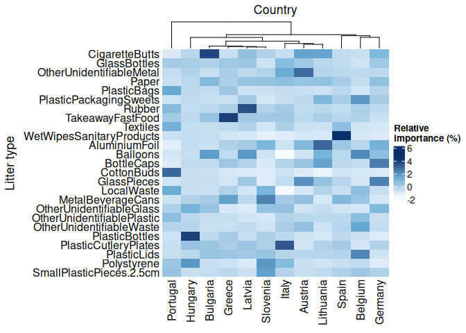<!-- -->

Dendrogram with the values

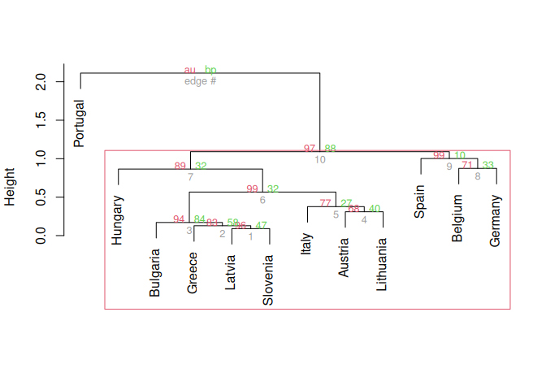<!-- -->

    ## png 
    ##   2

<!--
###### Litter type Proportion II - "Within‑country" proportions
&#10;* The second approach will be a "*Within‑country*" proportions. 
  * For each country, what fraction of its total litter is each type?
  * Total abundance of all types in that country.
&#10;
&#10;```
## # A tibble: 300 × 5
##    CountryResponsible Litter_type        Total_Abundance Country_Total Prop_Type
##    <chr>              <chr>                        <dbl>         <dbl>     <dbl>
##  1 austria            AluminiumFoil              0.243            11.1  0.0219  
##  2 austria            Balloons                   0.00360          11.1  0.000324
##  3 austria            BottleCaps                 0.281            11.1  0.0253  
##  4 austria            CigaretteButts             2.19             11.1  0.197   
##  5 austria            CottonBuds                 0.00184          11.1  0.000166
##  6 austria            GlassBottles               0.275            11.1  0.0248  
##  7 austria            GlassPieces                2.26             11.1  0.204   
##  8 austria            LocalWaste                 0.0581           11.1  0.00523 
##  9 austria            MetalBeverageCans          0.397            11.1  0.0358  
## 10 austria            OtherUnidentifiab…         0.0114           11.1  0.00103 
## # ℹ 290 more rows
```
&#10;
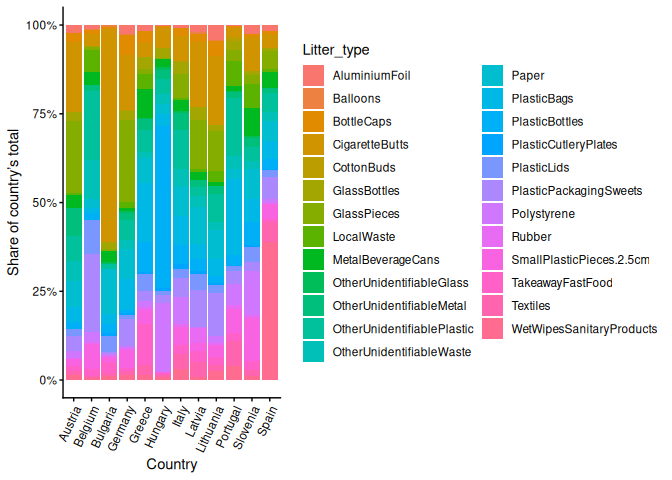<!-- -->

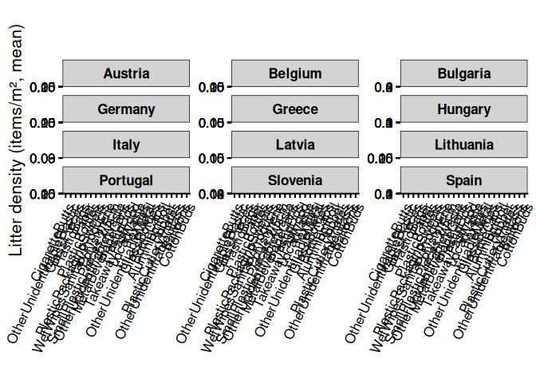<!-- -->

–\>

###### Multivariate Perspective

**Note on the Hellinger transformation.** The Hellinger transformation
divides each value by the total of its row (sampling) before taking the
square root, so it removes any constant that multiplies a whole row.
Dividing a sampling by its area is such a constant, so the
Hellinger-transformed matrix is the same whether we start from counts or
from densities. Therefore the PERMANOVA, betadisper, Random Forest, PCA
and nMDS below differ from the absolute-frequency version **only because
of the samplings removed by the area filter**, not because of the
standardisation itself.

In order to see if there are significant differences across country in
the community composition, we will perform a PERMANOVA test:

    ## Permutation test for adonis under reduced model
    ## Marginal effects of terms
    ## Permutation: free
    ## Number of permutations: 999
    ## 
    ## adonis2(formula = dist_mat ~ CountryResponsible, data = meta, permutations = 999, by = "margin", na.action = na.omit)
    ##                     Df SumOfSqs      R2      F Pr(>F)    
    ## CountryResponsible  11    26.37 0.09861 5.0621  0.001 ***
    ## Residual           509   241.04 0.90139                  
    ## Total              520   267.41 1.00000                  
    ## ---
    ## Signif. codes:  0 '***' 0.001 '**' 0.01 '*' 0.05 '.' 0.1 ' ' 1

So, we conclude that there are significant differences among countries.

We can look for **heterocedasticity** among countries (homogeneity of
multivariate dispersions), since PERMANOVA can also detect differences
in dispersion and not only in location:

    ## 
    ##  Homogeneity of multivariate dispersions
    ## 
    ## Call: betadisper(d = dist_mat, group = meta$CountryResponsible)
    ## 
    ## No. of Positive Eigenvalues: 25
    ## No. of Negative Eigenvalues: 0
    ## 
    ## Average distance to median:
    ##   austria   belgium  bulgaria   germany    greece   hungary     italy    latvia 
    ##    0.6550    0.7004    0.3731    0.6544    0.5943    0.6351    0.7045    0.6479 
    ## lithuania  portugal  slovenia     spain 
    ##    0.6720    0.6892    0.6402    0.6989 
    ## 
    ## Eigenvalues for PCoA axes:
    ## (Showing 8 of 25 eigenvalues)
    ## PCoA1 PCoA2 PCoA3 PCoA4 PCoA5 PCoA6 PCoA7 PCoA8 
    ## 38.59 24.30 22.36 20.05 17.39 16.14 15.54 13.21

    ## 
    ## Permutation test for homogeneity of multivariate dispersions
    ## Permutation: free
    ## Number of permutations: 999
    ## 
    ## Response: Distances
    ##            Df Sum Sq  Mean Sq     F N.Perm Pr(>F)    
    ## Groups     11 1.1999 0.109078 6.913    999  0.001 ***
    ## Residuals 509 8.0313 0.015779                        
    ## ---
    ## Signif. codes:  0 '***' 0.001 '**' 0.01 '*' 0.05 '.' 0.1 ' ' 1

The multivariate dispersion **differs significantly** among countries
(betadisper; F = 6.91, p = 0.001), so part of the PERMANOVA result may
reflect differences in within-country variability rather than only in
composition.

But what are the items that explain these differences?

The answer will be addressed by performing a **Multivariate Random
Forest**.

    ## 
    ## Call:
    ##  randomForest(x = comm_hel, y = as.factor(meta$CountryResponsible),      ntree = 500, importance = TRUE) 
    ##                Type of random forest: classification
    ##                      Number of trees: 500
    ## No. of variables tried at each split: 5
    ## 
    ##         OOB estimate of  error rate: 65.64%
    ## Confusion matrix:
    ##           austria belgium bulgaria germany greece hungary italy latvia
    ## austria        25       3        0      11      0       0     4      0
    ## belgium         5       4        0       4      0       0     1      0
    ## bulgaria        0       0        9       0      0       1     0      0
    ## germany        13       2        0      34      0       0     2      0
    ## greece          1       0        0       0      0       0     7      0
    ## hungary         4       0        0       0      0       2     2      0
    ## italy           8       2        0       5      0       0    11      0
    ## latvia          0       0        0       2      0       0     0      0
    ## lithuania       8       5        0      22      0       0     0      0
    ## portugal        5       3        0       5      0       0     3      0
    ## slovenia        2       0        0       1      0       1     3      0
    ## spain          12       6        0       5      0       1     6      0
    ##           lithuania portugal slovenia spain class.error
    ## austria           7        2        0    18   0.6428571
    ## belgium          16        3        1    12   0.9130435
    ## bulgaria          0        0        0     0   0.1000000
    ## germany          22        4        0     4   0.5802469
    ## greece            1        1        0     1   1.0000000
    ## hungary           1        0        0     6   0.8666667
    ## italy             4        5        0    10   0.7555556
    ## latvia            6        0        0     0   1.0000000
    ## lithuania        46        0        0     8   0.4831461
    ## portugal          8        9        0     9   0.7857143
    ## slovenia          1        3        1    10   0.9545455
    ## spain            13        1        0    38   0.5365854

Decisions have to be taken carefully since the prediction accuracy is
very low (0.34). Furthermore, the estimated error rate (OOB) is high, so
conclusion have to be taken with care.

Eventhough, the more important (differential across countries) litter
components are:

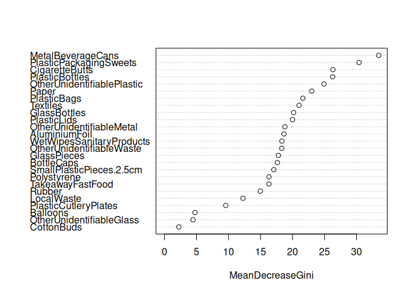

This plot of variable importance importance is telling us:

<!--
*  A large `MeanDecreaseAccuracy` (**MDA**) means that, when you break the relationship between that predictor and the response, the model’s accuracy suffers a lot → it’s an important predictor for correct country assignments. 
  * **MDA** is generally the more reliable gauge of predictive importance, since it directly measures impact on OOB‐accuracy.
-->

- A large `MeanDecreaseGini` (**MDG**) means that X frequently appears
  in high‑up the tree splits and yields big purity gains → it’s
  structurally important to partitioning the data.
  - **MDG** tells you which features the trees “prefer” splitting on.
- **Principal Component Analysis**

We will perform a Principal Component Analysis (PCA) to see correlation
among litter items and *possible* associations with countries

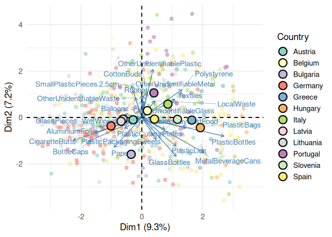<!-- -->

And the most important Items for the two forst principal components are:

- First PC
  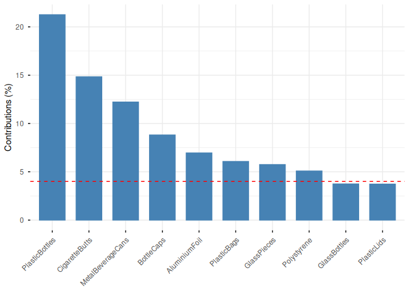<!-- -->

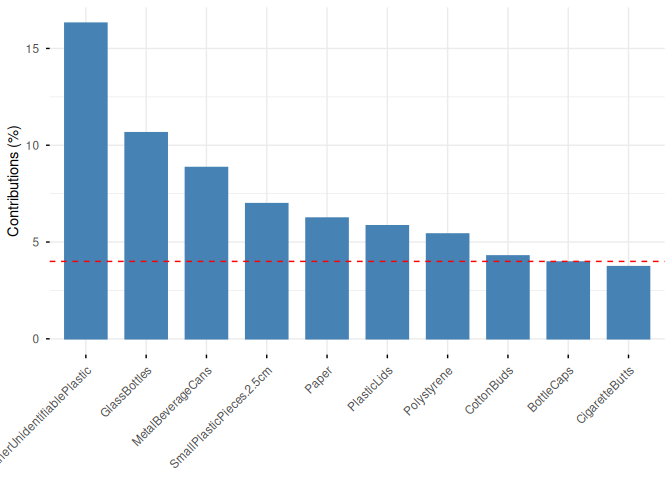<!-- -->

- **Non-Metric Multidimensional Scaling - nMDS**

We will perform a Non-Metric Multidimensional Scaling (nMDS) to see
correlation among litter items and *possible* associations with
countries.

We can re-use the distance matrix using the hellinger‐transformed data
(`comm_hel`) and then perform the nMDS.

    ## [1] 0

    ## integer(0)

    ## Run 0 stress 0.2889439 
    ## Run 1 stress 0.3006663 
    ## Run 2 stress 0.2907211 
    ## Run 3 stress 0.2910531 
    ## Run 4 stress 0.2933236 
    ## Run 5 stress 0.2946046 
    ## Run 6 stress 0.2908427 
    ## Run 7 stress 0.3038099 
    ## Run 8 stress 0.2894206 
    ## ... Procrustes: rmse 0.01155062  max resid 0.1298664 
    ## Run 9 stress 0.3014896 
    ## Run 10 stress 0.2900014 
    ## Run 11 stress 0.2897078 
    ## Run 12 stress 0.2893867 
    ## ... Procrustes: rmse 0.0111103  max resid 0.1017889 
    ## Run 13 stress 0.305709 
    ## Run 14 stress 0.2998139 
    ## Run 15 stress 0.2907605 
    ## Run 16 stress 0.2914311 
    ## Run 17 stress 0.2891941 
    ## ... Procrustes: rmse 0.008956378  max resid 0.07087521 
    ## Run 18 stress 0.3023404 
    ## Run 19 stress 0.2895726 
    ## Run 20 stress 0.3027583 
    ## *** Best solution was not repeated -- monoMDS stopping criteria:
    ##     16: no. of iterations >= maxit
    ##      4: stress ratio > sratmax

Now, we calculate the scores for the sites (samples) and add the
metadata to be able to visualize the nMDS with the country information.

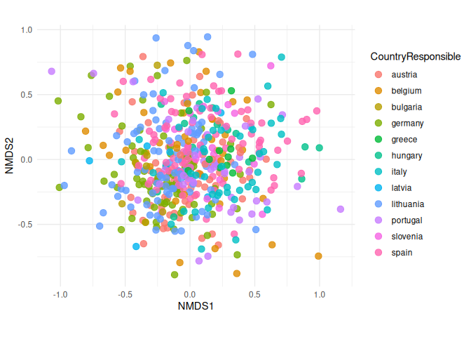<!-- -->

To see which countries are more similar than others, we can calculate
the centroids of each country in the NMDS space and then plot them.

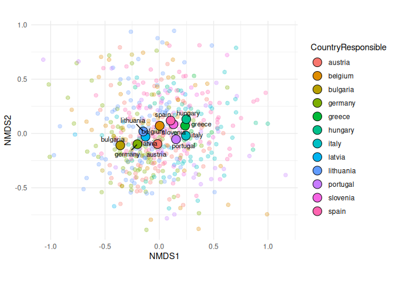<!-- -->

From the above plot, we can say that the non-metric multidimensional
scaling ordination based on Bray–Curtis dissimilarities of
Hellinger-transformed litter composition revealed a clear gradient along
the first two NMDS axes. Countries are arranged in a roughly linear
sequence in this ordination space, indicating systematic shifts in the
relative contribution of the different litter categories rather than
discrete clusters. This pattern suggests that national litter profiles
form a continuum, with some countries showing more similar compositions
and therefore grouping closer together, while others occupy more distant
positions along the gradient. Taken together, the NMDS indicates that
between-country variation in litter is primarily structured along one
dominant compositional axis, with a secondary axis capturing finer
differences among otherwise similar profiles.

#### Group B: Single Use Plastic - Riverside Waste

We wil take as a subset the single use plastic (`SUP`) for the group B.

    ##   DatasetID CountryResponsible SamplingCampaign SamplingYear
    ## 1   at_6270            austria      autumn 2022         2022
    ## 2   at_6297            austria      autumn 2022         2022
    ## 3   at_6382            austria      autumn 2022         2022
    ## 4   at_6393            austria      autumn 2022         2022
    ## 5   at_6429            austria      autumn 2022         2022
    ## 6   at_6448            austria      autumn 2022         2022
    ##   SamplingCoordinatesLatitude SamplingCoordinatesLongitude SamplingRiverSystem
    ## 1                    48.04275                     14.42192              Danube
    ## 2                    48.26034                     13.03440              Danube
    ## 3                    47.11828                     13.81419              Danube
    ## 4                    46.58301                     13.84115              Danube
    ## 5                    48.21108                     16.43973              Danube
    ## 6                    46.60477                     14.27800              Danube
    ##   SamplingParticipants RiversideWasteVariety_AttemptedSampling
    ## 1                    9                                       1
    ## 2                    8                                       1
    ## 3                   20                                       1
    ## 4                   38                                       1
    ## 5                   20                                       1
    ## 6                   16                                       1
    ##   RiversideWasteVariety_Qualified PlasticBags PlasticBottles  PlasticLids
    ## 1                               1 0.005555556    0.000000000 0.0000000000
    ## 2                               1 0.000000000    0.000170068 0.0006802721
    ## 3                               1 0.000000000    0.000000000 0.0000000000
    ## 4                               1 0.012454212    0.008058608 0.0047619048
    ## 5                               1 0.001861702    0.005851064 0.0045212766
    ## 6                               1 0.005000000    0.006666667 0.0016666667
    ##   TakeawayFastFood PlasticCutleryPlates PlasticPackagingSweets   CottonBuds
    ## 1     0.0055555556         0.0000000000            0.002777778 0.0000000000
    ## 2     0.0001700680         0.0001700680            0.002380952 0.0000000000
    ## 3     0.0000000000         0.0000000000            0.002000000 0.0000000000
    ## 4     0.0007326007         0.0000000000            0.012454212 0.0000000000
    ## 5     0.0023936170         0.0007978723            0.002659574 0.0005319149
    ## 6     0.0050000000         0.0000000000            0.001666667 0.0000000000
    ##   WetWipesSanitaryProducts Polystyrene
    ## 1             0.0027777778 0.000000000
    ## 2             0.0005102041 0.000000000
    ## 3             0.0000000000 0.001000000
    ## 4             0.0000000000 0.000000000
    ## 5             0.0018617021 0.001595745
    ## 6             0.0000000000 0.000000000

    ##    DatasetID   CountryResponsible    SamplingCampaign  SamplingYear 
    ##  at_6270:  1   Length   :527      autumn 2021:  0     Min.   :2022  
    ##  at_6297:  1   N.unique : 12      autumn 2022:184     1st Qu.:2022  
    ##  at_6382:  1   N.blank  :  0      autumn 2023:138     Median :2023  
    ##  at_6393:  1   Min.nchar:  5      autumn 2024: 50     Mean   :2023  
    ##  at_6429:  1   Max.nchar:  9      spring 2022:  1     3rd Qu.:2024  
    ##  at_6448:  1                      spring 2023: 25     Max.   :2024  
    ##  (Other):521                      spring 2024:129                   
    ##  SamplingCoordinatesLatitude SamplingCoordinatesLongitude SamplingRiverSystem
    ##  Min.   :37.18               Min.   :-9.309               Length   :527      
    ##  1st Qu.:42.03               1st Qu.: 2.912               N.unique : 44      
    ##  Median :48.12               Median :12.375               N.blank  :  0      
    ##  Mean   :47.58               Mean   :11.013               Min.nchar:  2      
    ##  3rd Qu.:51.43               3rd Qu.:19.074               Max.nchar: 27      
    ##  Max.   :57.75               Max.   :27.488                                  
    ##                                                                              
    ##  SamplingParticipants RiversideWasteVariety_AttemptedSampling
    ##  Min.   :  2.0        Min.   :1                              
    ##  1st Qu.: 13.0        1st Qu.:1                              
    ##  Median : 19.0        Median :1                              
    ##  Mean   : 19.5        Mean   :1                              
    ##  3rd Qu.: 24.0        3rd Qu.:1                              
    ##  Max.   :250.0        Max.   :1                              
    ##  NAs    :8                                                   
    ##  RiversideWasteVariety_Qualified  PlasticBags       PlasticBottles   
    ##  Min.   :1                       Min.   :0.000000   Min.   :0.00000  
    ##  1st Qu.:1                       1st Qu.:0.000000   1st Qu.:0.00000  
    ##  Median :1                       Median :0.002133   Median :0.00100  
    ##  Mean   :1                       Mean   :0.026745   Mean   :0.01541  
    ##  3rd Qu.:1                       3rd Qu.:0.008002   3rd Qu.:0.00500  
    ##  Max.   :1                       Max.   :3.458647   Max.   :2.61818  
    ##                                                                      
    ##   PlasticLids       TakeawayFastFood   PlasticCutleryPlates
    ##  Min.   :0.000000   Min.   :0.000000   Min.   :0.000000    
    ##  1st Qu.:0.000000   1st Qu.:0.000000   1st Qu.:0.000000    
    ##  Median :0.001000   Median :0.000000   Median :0.000000    
    ##  Mean   :0.007177   Mean   :0.004960   Mean   :0.001204    
    ##  3rd Qu.:0.004083   3rd Qu.:0.002302   3rd Qu.:0.000000    
    ##  Max.   :1.150000   Max.   :0.300752   Max.   :0.070000    
    ##                                                            
    ##  PlasticPackagingSweets   CottonBuds        WetWipesSanitaryProducts
    ##  Min.   :0.0000000      Min.   :0.0000000   Min.   :0.00000         
    ##  1st Qu.:0.0008333      1st Qu.:0.0000000   1st Qu.:0.00000         
    ##  Median :0.0038750      Median :0.0000000   Median :0.00000         
    ##  Mean   :0.0185590      Mean   :0.0009087   Mean   :0.01996         
    ##  3rd Qu.:0.0120000      3rd Qu.:0.0000000   3rd Qu.:0.00200         
    ##  Max.   :2.3000000      Max.   :0.1780000   Max.   :1.89700         
    ##                                                                     
    ##   Polystyrene     
    ##  Min.   :0.00000  
    ##  1st Qu.:0.00000  
    ##  Median :0.00000  
    ##  Mean   :0.01236  
    ##  3rd Qu.:0.00200  
    ##  Max.   :1.15500  
    ## 

###### SUP type density (items/m²)

We will obtain the plot for the most common (average density, items/m²)
Single Use Plastic type
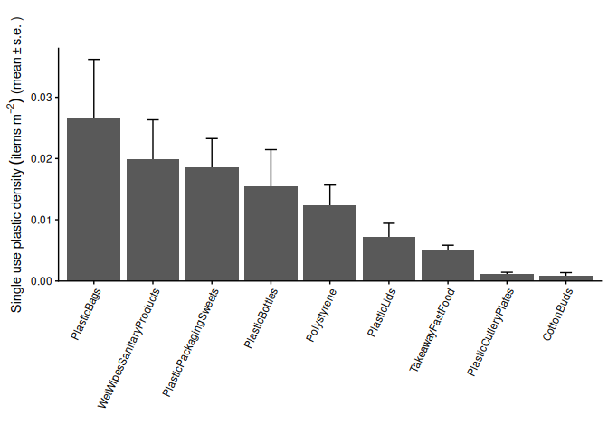<!-- -->

###### SUP type density per country

If we now want to visualize the contribution per each country, we have:

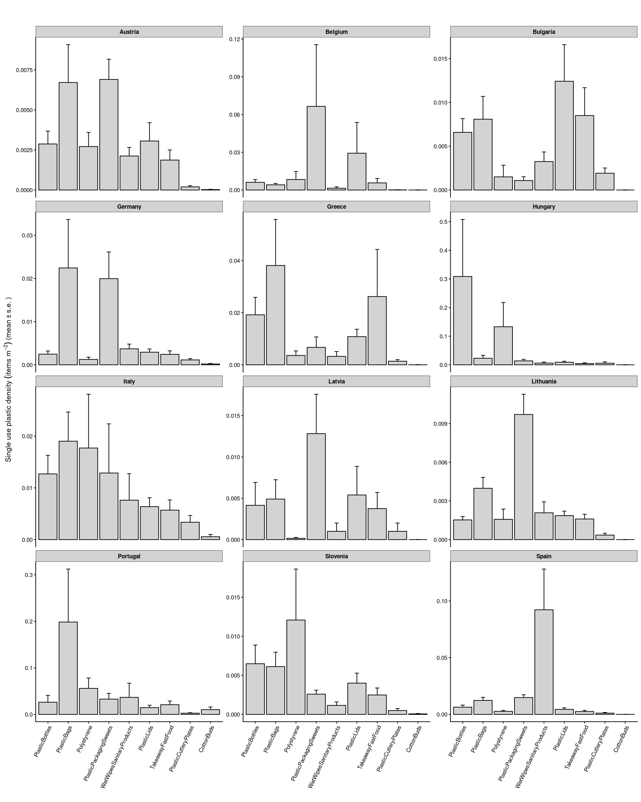<!-- -->

###### Manuscript values: SUP mean ± s.e. and n (Fig. 8 and Fig. 9)

Mean ± standard error (items/m², four decimals) and *n* for the SUP
categories and countries cited in the Results section (uses
`litter_mean_se()`, defined in the Group B section).

    ## # A tibble: 3 × 5
    ##   Litter_type                  n   Mean      SE Manuscript              
    ##   <chr>                    <int>  <dbl>   <dbl> <chr>                   
    ## 1 PlasticBags                527 0.0267 0.00944 0.0267 ± 0.0094, n = 527
    ## 2 WetWipesSanitaryProducts   527 0.0200 0.00636 0.0200 ± 0.0064, n = 527
    ## 3 PlasticPackagingSweets     527 0.0186 0.00470 0.0186 ± 0.0047, n = 527

    ## # A tibble: 8 × 3
    ##   Litter_type      CountryResponsible Manuscript             
    ##   <chr>            <chr>              <chr>                  
    ## 1 PlasticBags      Italy              0.0190 ± 0.0056, n = 45
    ## 2 PlasticBags      Greece             0.0381 ± 0.0177, n = 11
    ## 3 Polystyrene      Portugal           0.0559 ± 0.0223, n = 42
    ## 4 Polystyrene      Slovenia           0.0121 ± 0.0065, n = 22
    ## 5 PlasticBottles   Hungary            0.3085 ± 0.1992, n = 15
    ## 6 PlasticBottles   Greece             0.0192 ± 0.0067, n = 11
    ## 7 PlasticLids      Bulgaria           0.0124 ± 0.0042, n = 10
    ## 8 TakeawayFastFood Bulgaria           0.0085 ± 0.0032, n = 10

###### SUP type Proportion I - “Across‑type” proportions

- The first approach will be a “*Across‑type*” proportions.
  - total abundance of that litter type over each total country.

<!--
    * For each litter type, what fraction comes from each country? (not from an european total) 
    -->

    ## # A tibble: 108 × 5
    ##    CountryResponsible Litter_type      Total_Abundance Global_Total Prop_Country
    ##    <chr>              <chr>                      <dbl>        <dbl>        <dbl>
    ##  1 austria            CottonBuds              0.00184         0.479     0.00384 
    ##  2 austria            PlasticBags             0.470          14.1       0.0334  
    ##  3 austria            PlasticBottles          0.201           8.12      0.0248  
    ##  4 austria            PlasticCutleryP…        0.0137          0.634     0.0216  
    ##  5 austria            PlasticLids             0.214           3.78      0.0567  
    ##  6 austria            PlasticPackagin…        0.483           9.78      0.0494  
    ##  7 austria            Polystyrene             0.190           6.51      0.0292  
    ##  8 austria            TakeawayFastFood        0.131           2.61      0.0501  
    ##  9 austria            WetWipesSanitar…        0.149          10.5       0.0141  
    ## 10 belgium            CottonBuds              0.000468        0.479     0.000978
    ## # ℹ 98 more rows

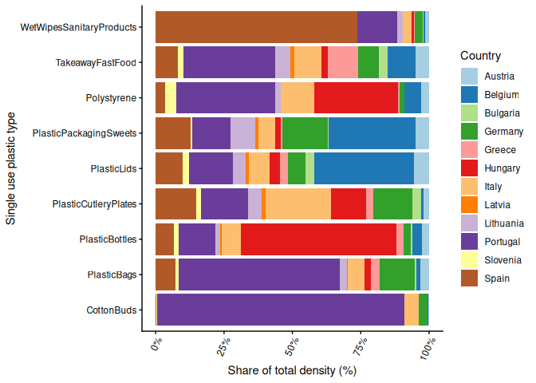<!-- -->

<!--
&#10;* Now, considering the total of Europe
&#10;
```
## # A tibble: 108 × 5
##    CountryResponsible Litter_type  Total_Abundance European_Total Prop_of_Europe
##    <chr>              <fct>                  <dbl>          <dbl>          <dbl>
##  1 Austria            CottonBuds          0.00184           0.479       0.00384 
##  2 Austria            PlasticBags         0.470            14.1         0.0334  
##  3 Austria            PlasticBott…        0.201             8.12        0.0248  
##  4 Austria            PlasticCutl…        0.0137            0.634       0.0216  
##  5 Austria            PlasticLids         0.214             3.78        0.0567  
##  6 Austria            PlasticPack…        0.483             9.78        0.0494  
##  7 Austria            Polystyrene         0.190             6.51        0.0292  
##  8 Austria            TakeawayFas…        0.131             2.61        0.0501  
##  9 Austria            WetWipesSan…        0.149            10.5         0.0141  
## 10 Belgium            CottonBuds          0.000468          0.479       0.000978
## # ℹ 98 more rows
```
&#10;
&#10;
&#10;
-->

- HeatMaps

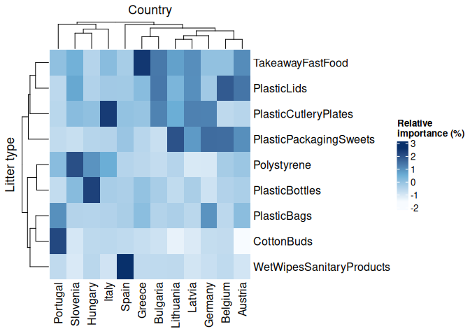

<!--
&#10;###### SUP type Proportion II - "Within‑country" proportions
&#10;* The second approach will be a "*Within‑country*" proportions. 
  * For each country, what fraction of its total litter is each type?
  * Total abundance of all types in that country.
&#10;
&#10;```
## # A tibble: 108 × 5
##    CountryResponsible Litter_type        Total_Abundance Country_Total Prop_Type
##    <chr>              <chr>                        <dbl>         <dbl>     <dbl>
##  1 austria            CottonBuds                0.00184           1.85 0.000992 
##  2 austria            PlasticBags               0.470             1.85 0.254    
##  3 austria            PlasticBottles            0.201             1.85 0.109    
##  4 austria            PlasticCutleryPla…        0.0137            1.85 0.00741  
##  5 austria            PlasticLids               0.214             1.85 0.116    
##  6 austria            PlasticPackagingS…        0.483             1.85 0.261    
##  7 austria            Polystyrene               0.190             1.85 0.103    
##  8 austria            TakeawayFastFood          0.131             1.85 0.0706   
##  9 austria            WetWipesSanitaryP…        0.149             1.85 0.0801   
## 10 belgium            CottonBuds                0.000468          5.71 0.0000820
## # ℹ 98 more rows
```
&#10;
&#10;
&#10;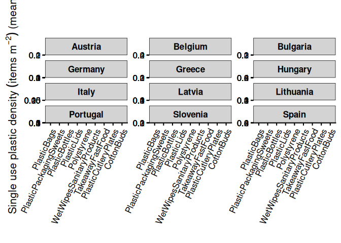<!-- -->

–\>

###### SUP Multivariate Perspective

**Note on the Hellinger transformation.** The Hellinger transformation
divides each value by the total of its row (sampling) before taking the
square root, so it removes any constant that multiplies a whole row.
Dividing a sampling by its area is such a constant, so the
Hellinger-transformed matrix is the same whether we start from counts or
from densities. Therefore the PERMANOVA, betadisper, Random Forest and
PCA below differ from the absolute-frequency version **only because of
the samplings removed by the area filter**, not because of the
standardisation itself.

In order to see if there are significant differences across country in
the community composition, we will perform a PERMANOVA test:

    ## Permutation test for adonis under reduced model
    ## Marginal effects of terms
    ## Permutation: free
    ## Number of permutations: 999
    ## 
    ## adonis2(formula = dist_mat_SUP ~ CountryResponsible, data = meta_SUP, permutations = 999, by = "margin")
    ##                     Df SumOfSqs      R2      F Pr(>F)    
    ## CountryResponsible  11   22.071 0.10057 5.1028  0.001 ***
    ## Residual           502  197.385 0.89943                  
    ## Total              513  219.456 1.00000                  
    ## ---
    ## Signif. codes:  0 '***' 0.001 '**' 0.01 '*' 0.05 '.' 0.1 ' ' 1

So, we conclude that there are significant differences among countries.
The R-Square value (0.101) means that the country “effects” explain
10.1% of the total variability. 89.9% is the remaining (unexplained)
variability among countries. ***There is a significant country effect,
but is small***.

Or even better: **There are statistically significant multivariate
differences in litter composition among countries, although the effect
size is modest (R² = 0.101).**

We can look for **heterocedasticity** among countries

    ## 
    ##  Homogeneity of multivariate dispersions
    ## 
    ## Call: betadisper(d = dist_mat_SUP, group = meta_SUP$CountryResponsible)
    ## 
    ## No. of Positive Eigenvalues: 9
    ## No. of Negative Eigenvalues: 0
    ## 
    ## Average distance to median:
    ##   austria   belgium  bulgaria   germany    greece   hungary     italy    latvia 
    ##    0.6174    0.5836    0.5416    0.5940    0.4907    0.5711    0.6421    0.4790 
    ## lithuania  portugal  slovenia     spain 
    ##    0.5726    0.6062    0.5941    0.6275 
    ## 
    ## Eigenvalues for PCoA axes:
    ## (Showing 8 of 9 eigenvalues)
    ##  PCoA1  PCoA2  PCoA3  PCoA4  PCoA5  PCoA6  PCoA7  PCoA8 
    ## 60.951 37.620 33.969 28.494 21.410 18.261 10.483  6.625

    ## 
    ## Permutation test for homogeneity of multivariate dispersions
    ## Permutation: free
    ## Number of permutations: 999
    ## 
    ## Response: Distances
    ##            Df  Sum Sq  Mean Sq      F N.Perm Pr(>F)  
    ## Groups     11  0.5371 0.048831 1.6859    999  0.078 .
    ## Residuals 502 14.5401 0.028964                       
    ## ---
    ## Signif. codes:  0 '***' 0.001 '**' 0.01 '*' 0.05 '.' 0.1 ' ' 1

The multivariate dispersion **does not differ significantly** among
countries (betadisper; F = 1.69, p = 0.078), so the PERMANOVA result
reflects differences in composition rather than in within-country
variability. There is a Country effect but it is small.

If we need to parametrize this model, we should use a Mixed Multivariate
Model (necessary?)

but What are the items that explains these differences?

The answer will be addressed by performing a **Multivariate Random
Forest**.

    ## 
    ## Call:
    ##  randomForest(x = comm_hel_SUP, y = as.factor(meta_SUP$CountryResponsible),      ntree = 500, importance = TRUE) 
    ##                Type of random forest: classification
    ##                      Number of trees: 500
    ## No. of variables tried at each split: 3
    ## 
    ##         OOB estimate of  error rate: 75.29%
    ## Confusion matrix:
    ##           austria belgium bulgaria germany greece hungary italy latvia
    ## austria        14       3        0      13      1       0     6      0
    ## belgium         5       4        1       9      0       0     4      0
    ## bulgaria        2       1        5       0      0       0     2      0
    ## germany         8       2        0      23      0       1     6      0
    ## greece          2       0        1       0      0       1     6      0
    ## hungary         1       1        1       1      0       3     4      0
    ## italy           7       4        0       8      0       0    16      0
    ## latvia          2       0        0       3      0       0     0      0
    ## lithuania      11       6        0      18      0       0     4      0
    ## portugal        9       3        0       6      0       1     0      0
    ## slovenia        3       1        0       4      1       0     4      0
    ## spain          11       8        1      15      1       1     8      0
    ##           lithuania portugal slovenia spain class.error
    ## austria          16        6        1    10   0.8000000
    ## belgium          12        2        0     6   0.9069767
    ## bulgaria          0        0        0     0   0.5000000
    ## germany          25        4        0    11   0.7125000
    ## greece            0        0        1     0   1.0000000
    ## hungary           3        0        0     1   0.8000000
    ## italy             3        1        1     5   0.6444444
    ## latvia            2        0        0     1   1.0000000
    ## lithuania        34        2        1    12   0.6136364
    ## portugal          7        7        3     4   0.8250000
    ## slovenia          3        3        0     3   1.0000000
    ## spain            12        3        1    21   0.7439024

Decisions have to be taken carefully since the prediction accuracy is
very low (0.25). Furthermore, the estimated error rate (OOB) is high, so
conclusion have to be taken with care.

Even though, the more important (differential across countries) litter
components are:

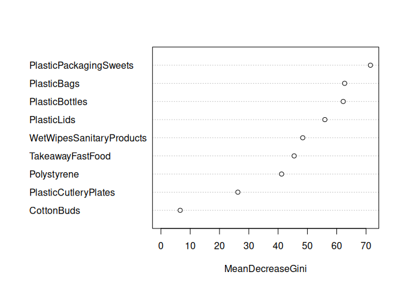<!-- -->

This plot of variable importance importance is telling us:

- A large `MeanDecreaseAccuracy` (**MDA**) means that, when you break
  the relationship between that predictor and the response, the model’s
  accuracy suffers a lot → it’s an important predictor for correct
  country assignments.

- **MDA** is generally the more reliable gauge of predictive importance,
  since it directly measures impact on OOB‐accuracy.

- A large `MeanDecreaseGini` (**MDG**) means that X frequently appears
  in high‑up the tree splits and yields big purity gains → it’s
  structurally important to partitioning the data.

  - **MDG** is faster to compute and tells you which features the trees
    “prefer” splitting on, but can overweight high–cardinality or
    continuous variables.

Finally, we will perform a Principal Component Analysis (PCA) to see
correlation among litter items and *possible* associations with
countries

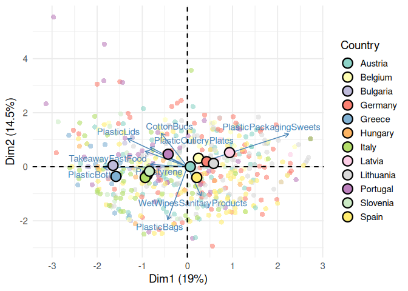<!-- -->

And the most important Items for the two forst principal components are:

- First PC
  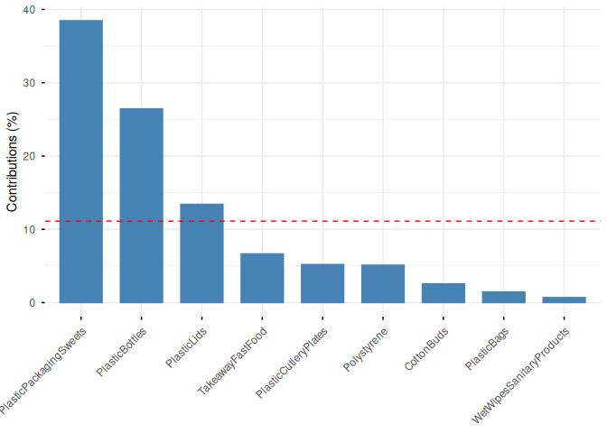<!-- -->

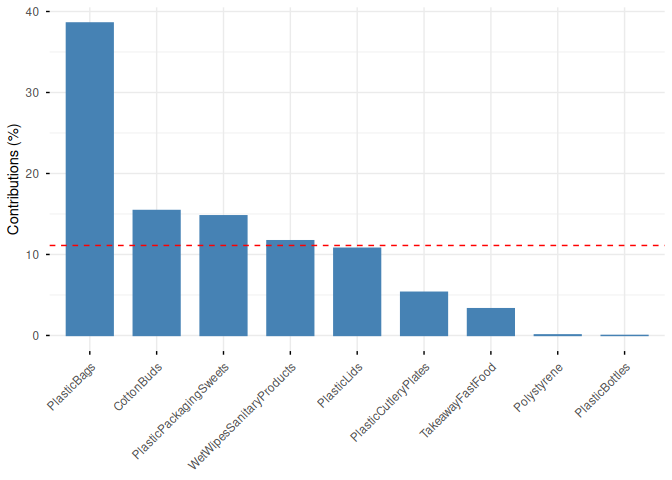<!-- -->

###### Manuscript values: Table 2 (PERMANOVA)

PERMANOVA results for the overall litter dataset (`perm1`) and the SUP
subset (`perm1_SUP`), in the layout of Table 2 of the manuscript.

    ##                    Analysis      Term  df      SS    F    R2 p_value
    ## 1          Overall analysis   Country  11  26.370 5.06 0.099   0.001
    ## 2          Overall analysis Residuals 509 241.042   NA 0.901      NA
    ## 3          Overall analysis     Total 520 267.412   NA 1.000      NA
    ## 4 Single-Use Plastics (SUP)   Country  11  22.071 5.10 0.101   0.001
    ## 5 Single-Use Plastics (SUP) Residuals 502 197.385   NA 0.899      NA
    ## 6 Single-Use Plastics (SUP)     Total 513 219.456   NA 1.000      NA

    ## # A tibble: 2 × 3
    ##   Analysis                      F p_value
    ##   <chr>                     <dbl>   <dbl>
    ## 1 Overall analysis           6.91   0.001
    ## 2 Single-Use Plastics (SUP)  1.69   0.078

## Floating DATA

### Data loading

    ## # A tibble: 375 × 15
    ##    DatasetID CountryResponsible SamplingYear SamplingAttempted DatasetQualified
    ##    <fct>     <chr>                     <dbl>             <dbl>            <dbl>
    ##  1 at_6270   Austria                    2022                 1                1
    ##  2 at_6297   Austria                    2022                 1                1
    ##  3 at_6349   Austria                    2022                 1                1
    ##  4 at_6372   Austria                    2022                 1                1
    ##  5 at_6382   Austria                    2022                 1                1
    ##  6 at_6393   Austria                    2022                 1                1
    ##  7 at_6414   Austria                    2022                 1                1
    ##  8 at_6448   Austria                    2022                 1                1
    ##  9 at_6703   Austria                    2023                 1                1
    ## 10 at_6718   Austria                    2023                 1                1
    ## # ℹ 365 more rows
    ## # ℹ 10 more variables: SamplingDate <date>, SamplingCoordinatesLatitude <dbl>,
    ## #   SamplingCoordinatesLongitude <dbl>, SamplingRiverSystem <fct>,
    ## #   FloatingMacro_AttemptedSampling <dbl>, FloatingMacro_Qualified <dbl>,
    ## #   FloatingMacro_ObservationTimeInMinutes <dbl>,
    ## #   FloatingMacro_RiverWidth <fct>, FloatingMacro_ObservedWidth <fct>,
    ## #   FloatingMacro_AmountOfFloatingMacrolitter <dbl>

#### Sampling Effor for Floating Data

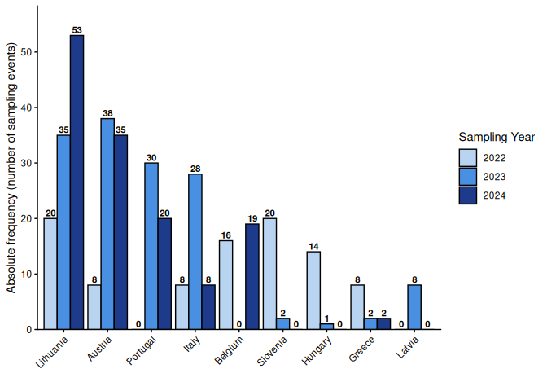<!-- -->

#### Macrolitter Flow calculation

The variable `FlowMacrolitter` is represented as the Number of floating
macrolitter $`m^{-1}`$ $`h^{-1}`$.

    ## # A tibble: 375 × 18
    ##    DatasetID CountryResponsible SamplingYear SamplingAttempted DatasetQualified
    ##    <fct>     <chr>                     <dbl>             <dbl>            <dbl>
    ##  1 at_6270   Austria                    2022                 1                1
    ##  2 at_6297   Austria                    2022                 1                1
    ##  3 at_6349   Austria                    2022                 1                1
    ##  4 at_6372   Austria                    2022                 1                1
    ##  5 at_6382   Austria                    2022                 1                1
    ##  6 at_6393   Austria                    2022                 1                1
    ##  7 at_6414   Austria                    2022                 1                1
    ##  8 at_6448   Austria                    2022                 1                1
    ##  9 at_6703   Austria                    2023                 1                1
    ## 10 at_6718   Austria                    2023                 1                1
    ## # ℹ 365 more rows
    ## # ℹ 13 more variables: SamplingDate <date>, SamplingCoordinatesLatitude <dbl>,
    ## #   SamplingCoordinatesLongitude <dbl>, SamplingRiverSystem <fct>,
    ## #   FloatingMacro_AttemptedSampling <dbl>, FloatingMacro_Qualified <dbl>,
    ## #   FloatingMacro_ObservationTimeInMinutes <dbl>,
    ## #   FloatingMacro_RiverWidth <fct>, FloatingMacro_ObservedWidth <fct>,
    ## #   FloatingMacro_AmountOfFloatingMacrolitter <dbl>, TimeInHours <dbl>, …

#### Macrolitter Flow Visualization

##### Differences across countries

Notes on the figures:

- **All sampling years are always shown** for every country.
  Country-year combinations without valid data are labelled **n.d.** (no
  data). This covers both years without floating samplings and years
  where the flow could not be calculated (e.g. the river width is
  missing).
- The number above each box is the number of valid samplings (*n*).
- Most flow values are exactly 0, so the y-axis uses a **square-root
  scale**. This spreads out the small values near zero while keeping the
  zeros, which a log scale cannot show. All observations are drawn as
  points over the boxes.
- No observations are removed from the plot. The previous version used
  `scale_y_continuous(limits = c(0, 1))`, which **dropped** the values
  above 1 before computing the boxplots.

<!-- -->

    ## # A tibble: 27 × 5
    ##    CountryResponsible SamplingYear n_samplings n_valid label
    ##    <chr>              <fct>              <int>   <int> <chr>
    ##  1 Austria            2022                   8       8 8    
    ##  2 Austria            2023                  38      36 36   
    ##  3 Austria            2024                  35      33 33   
    ##  4 Belgium            2022                  16       0 n.d. 
    ##  5 Belgium            2023                   0       0 n.d. 
    ##  6 Belgium            2024                  19      18 18   
    ##  7 Greece             2022                   8       8 8    
    ##  8 Greece             2023                   2       2 2    
    ##  9 Greece             2024                   2       1 1    
    ## 10 Hungary            2022                  14       8 8    
    ## # ℹ 17 more rows

- Boxplots per country, with the sampling years nested within each
  country on the x-axis:

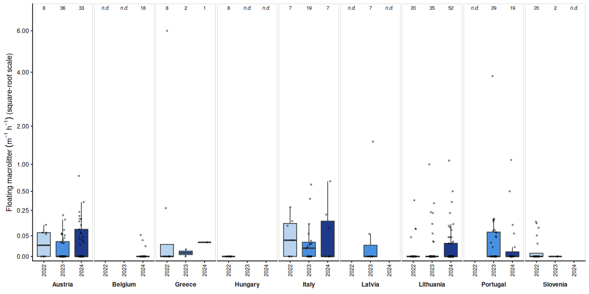<!-- -->

- Same data with one panel per sampling year (`facet_grid`), to compare
  countries within each year:

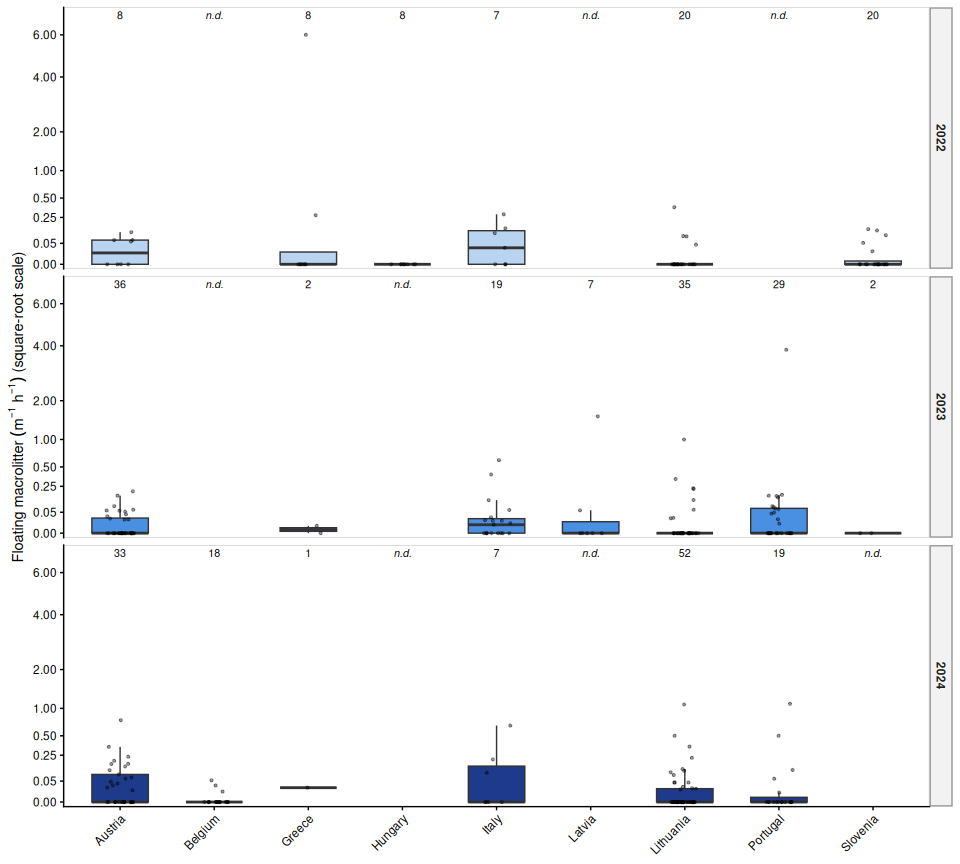<!-- -->

###### Manuscript values: low floating macrolitter densities

Summary of floating macrolitter flow (items m⁻¹ h⁻¹) per country,
pooling all years, to fill the sentence on the countries with low
densities (Belgium, Greece, Hungary and Latvia).

    ## # A tibble: 9 × 7
    ##   CountryResponsible     n Median  Mean    SE   Q75   Max
    ##   <chr>              <int>  <dbl> <dbl> <dbl> <dbl> <dbl>
    ## 1 Austria               77  0     0.047 0.012 0.059 0.764
    ## 2 Belgium               18  0     0.005 0.003 0     0.054
    ## 3 Greece                11  0     0.573 0.543 0.015 6    
    ## 4 Hungary                8  0     0     0     0     0    
    ## 5 Italy                 33  0.008 0.086 0.029 0.098 0.667
    ## 6 Latvia                 7  0     0.231 0.221 0.03  1.56 
    ## 7 Lithuania            107  0     0.051 0.016 0.009 1.08 
    ## 8 Portugal              48  0     0.139 0.083 0.063 3.83 
    ## 9 Slovenia              22  0     0.02  0.009 0     0.141

    ## # A tibble: 6 × 5
    ##   CountryResponsible SamplingYear     n Median   Max
    ##   <chr>              <fct>        <int>  <dbl> <dbl>
    ## 1 Belgium            2024            18  0     0.054
    ## 2 Greece             2022             8  0     6    
    ## 3 Greece             2023             2  0.003 0.006
    ## 4 Greece             2024             1  0.024 0.024
    ## 5 Hungary            2022             8  0     0    
    ## 6 Latvia             2023             7  0     1.56

- **Statistical test**

  - Generalize linear mixed model (Tweedie)

  Family error distribution was selected due to the data restriction
  (only positive values with high numbers of zeroes)

<!-- -->

    ##  Family: tweedie  ( log )
    ## Formula:          FlowMacrolitter ~ CountryResponsible
    ## Data: FlowData
    ## 
    ##       AIC       BIC    logLik -2*log(L)  df.resid 
    ##     290.0     331.8    -134.0     268.0       320 
    ## 
    ## 
    ## Dispersion parameter for tweedie family (): 2.16 
    ## 
    ## Conditional model:
    ##                               Estimate Std. Error z value Pr(>|z|)    
    ## (Intercept)                    -3.0551     0.3049 -10.018  < 2e-16 ***
    ## CountryResponsibleBelgium      -2.1601     1.0099  -2.139   0.0324 *  
    ## CountryResponsibleGreece        2.4984     0.5812   4.299 1.72e-05 ***
    ## CountryResponsibleHungary     -49.0697 22469.0664  -0.002   0.9983    
    ## CountryResponsibleItaly         0.6001     0.5143   1.167   0.2433    
    ## CountryResponsibleLatvia        1.5887     0.8014   1.982   0.0474 *  
    ## CountryResponsibleLithuania     0.0708     0.3976   0.178   0.8587    
    ## CountryResponsiblePortugal      1.0816     0.4367   2.477   0.0132 *  
    ## CountryResponsibleSlovenia     -0.8575     0.7405  -1.158   0.2469    
    ## ---
    ## Signif. codes:  0 '***' 0.001 '**' 0.01 '*' 0.05 '.' 0.1 ' ' 1

    ## Data: FlowData
    ## Models:
    ## mod_null: FlowMacrolitter ~ 1, zi=~0, disp=~1
    ## mod_full: FlowMacrolitter ~ CountryResponsible, zi=~0, disp=~1
    ##          Df    AIC    BIC  logLik deviance  Chisq Chi Df Pr(>Chisq)    
    ## mod_null  3 318.27 329.68 -156.14   312.27                             
    ## mod_full 11 290.01 331.83 -134.00   268.01 44.266      8  5.068e-07 ***
    ## ---
    ## Signif. codes:  0 '***' 0.001 '**' 0.01 '*' 0.05 '.' 0.1 ' ' 1

- Posthoc with multple comparisons

<!-- -->

    ##  contrast                ratio       SE  df null z.ratio p.value
    ##  Austria / Belgium    9.00e+00 9.00e+00 Inf    1   2.139  0.4464
    ##  Austria / Greece     0.00e+00 0.00e+00 Inf    1  -4.299  0.0006
    ##  Austria / Hungary    2.05e+21 4.60e+25 Inf    1   0.002  1.0000
    ##  Austria / Italy      1.00e+00 0.00e+00 Inf    1  -1.167  0.9634
    ##  Austria / Latvia     0.00e+00 0.00e+00 Inf    1  -1.982  0.5557
    ##  Austria / Lithuania  1.00e+00 0.00e+00 Inf    1  -0.178  1.0000
    ##  Austria / Portugal   0.00e+00 0.00e+00 Inf    1  -2.477  0.2431
    ##  Austria / Slovenia   2.00e+00 2.00e+00 Inf    1   1.158  0.9650
    ##  Belgium / Greece     0.00e+00 0.00e+00 Inf    1  -4.304  0.0006
    ##  Belgium / Hungary    2.36e+20 5.30e+24 Inf    1   0.002  1.0000
    ##  Belgium / Italy      0.00e+00 0.00e+00 Inf    1  -2.634  0.1726
    ##  Belgium / Latvia     0.00e+00 0.00e+00 Inf    1  -3.086  0.0524
    ##  Belgium / Lithuania  0.00e+00 0.00e+00 Inf    1  -2.240  0.3795
    ##  Belgium / Portugal   0.00e+00 0.00e+00 Inf    1  -3.203  0.0368
    ##  Belgium / Slovenia   0.00e+00 0.00e+00 Inf    1  -1.108  0.9732
    ##  Greece / Hungary     2.49e+22 5.59e+26 Inf    1   0.002  1.0000
    ##  Greece / Italy       7.00e+00 4.00e+00 Inf    1   2.942  0.0790
    ##  Greece / Latvia      2.00e+00 2.00e+00 Inf    1   1.021  0.9840
    ##  Greece / Lithuania   1.10e+01 6.00e+00 Inf    1   4.361  0.0004
    ##  Greece / Portugal    4.00e+00 2.00e+00 Inf    1   2.421  0.2722
    ##  Greece / Slovenia    2.90e+01 2.40e+01 Inf    1   4.011  0.0020
    ##  Hungary / Italy      0.00e+00 0.00e+00 Inf    1  -0.002  1.0000
    ##  Hungary / Latvia     0.00e+00 0.00e+00 Inf    1  -0.002  1.0000
    ##  Hungary / Lithuania  0.00e+00 0.00e+00 Inf    1  -0.002  1.0000
    ##  Hungary / Portugal   0.00e+00 0.00e+00 Inf    1  -0.002  1.0000
    ##  Hungary / Slovenia   0.00e+00 0.00e+00 Inf    1  -0.002  1.0000
    ##  Italy / Latvia       0.00e+00 0.00e+00 Inf    1  -1.164  0.9638
    ##  Italy / Lithuania    2.00e+00 1.00e+00 Inf    1   1.088  0.9761
    ##  Italy / Portugal     1.00e+00 0.00e+00 Inf    1  -0.928  0.9914
    ##  Italy / Slovenia     4.00e+00 3.00e+00 Inf    1   1.841  0.6547
    ##  Latvia / Lithuania   5.00e+00 4.00e+00 Inf    1   1.937  0.5880
    ##  Latvia / Portugal    2.00e+00 1.00e+00 Inf    1   0.630  0.9994
    ##  Latvia / Slovenia    1.20e+01 1.20e+01 Inf    1   2.441  0.2618
    ##  Lithuania / Portugal 0.00e+00 0.00e+00 Inf    1  -2.505  0.2291
    ##  Lithuania / Slovenia 3.00e+00 2.00e+00 Inf    1   1.287  0.9355
    ##  Portugal / Slovenia  7.00e+00 5.00e+00 Inf    1   2.608  0.1832
    ## 
    ## P value adjustment: tukey method for comparing a family of 9 estimates 
    ## Tests are performed on the log scale
